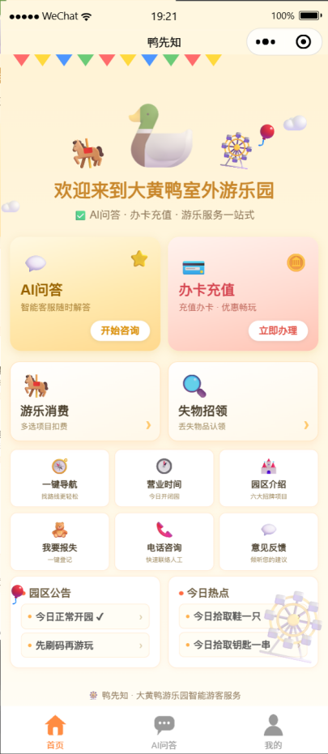
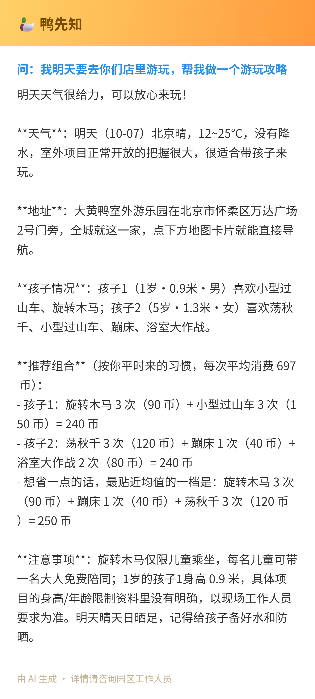
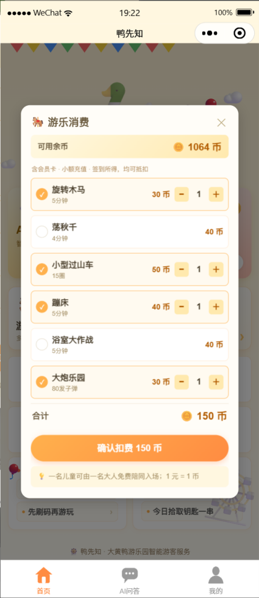
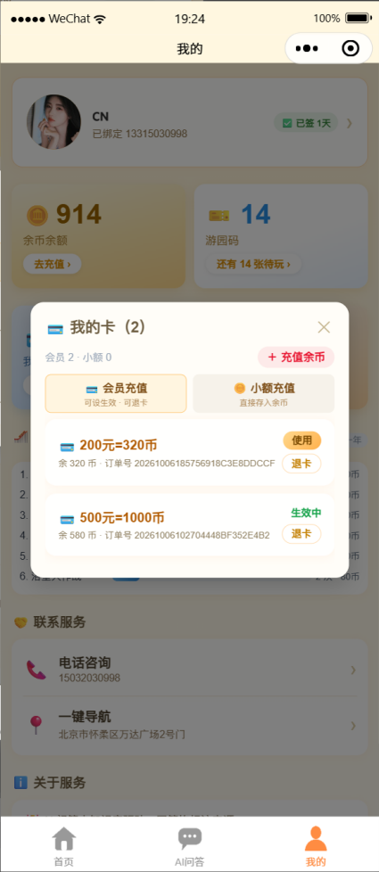
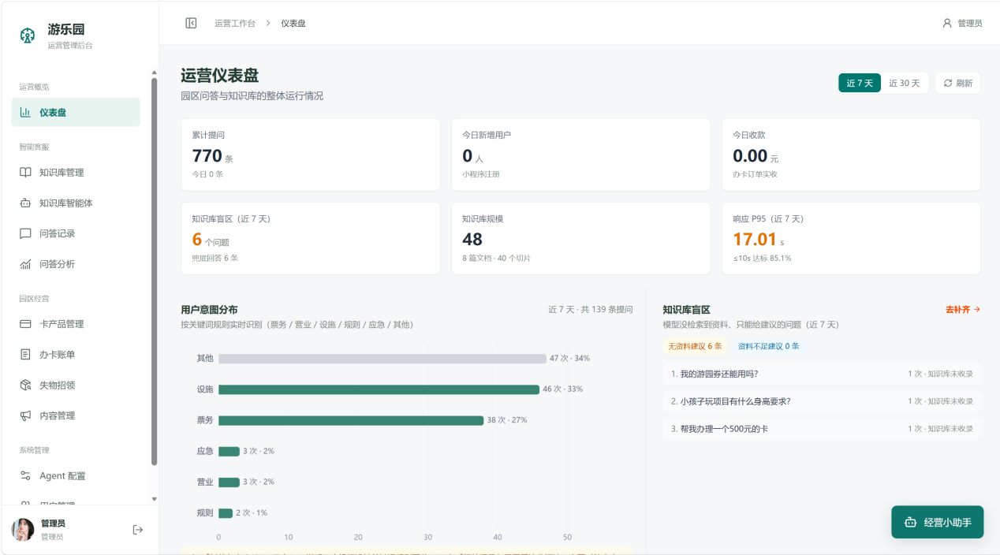
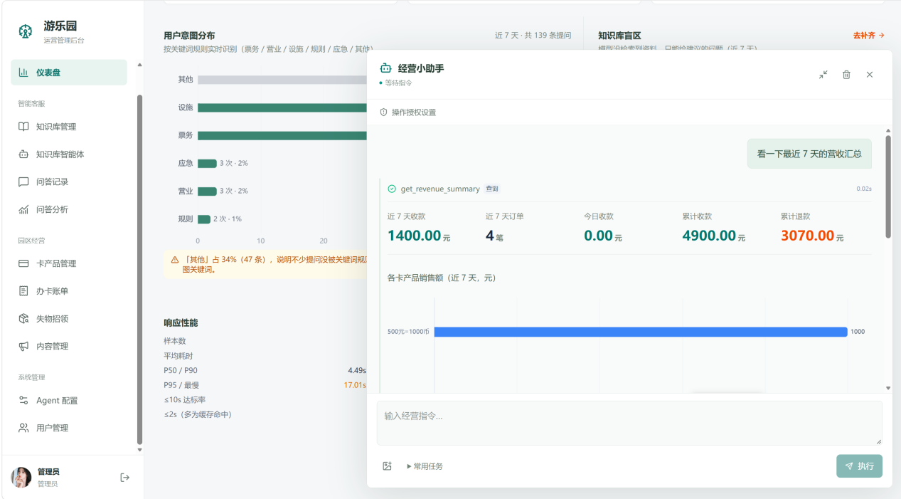
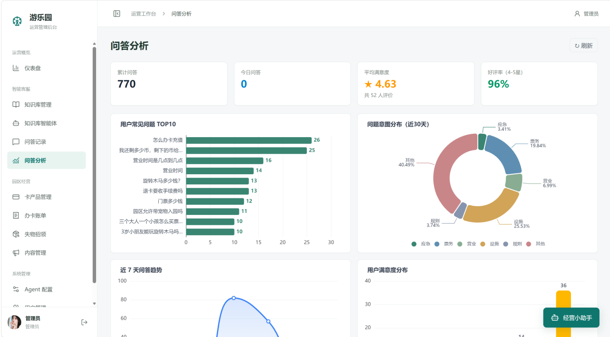
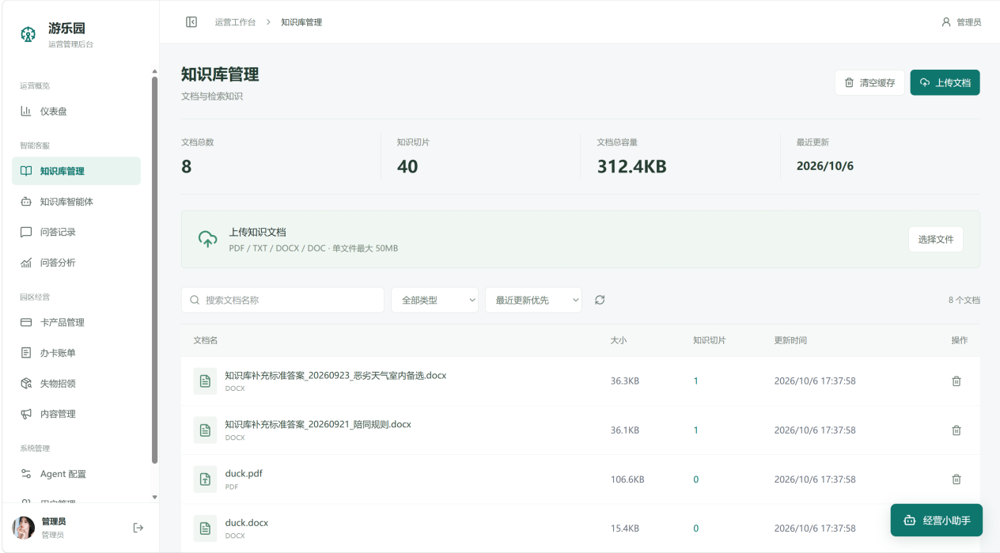

# 🎢 鸭先知 · 大黄鸭游乐园智能问答与运营系统

一套面向 **游乐园（大黄鸭室外游乐园）** 的智能客服与门店数字化系统：
**微信小程序（游客端）+ 商家 PC 管理端（运营后台）+ FastAPI 多 Agent 后端**。

- 游客在微信小程序里问票价 / 路线 / 失物 / 办卡，AI 不只"念文档"：它会真实地查余额、签到、查失物库、算"剩 120 币能玩什么"、推荐办卡并给出一键办理按钮；
- AI 记得用户（服务端结构化多轮 + 用户画像），回答完给出"依据上下文"的追问；
- 商家在 PC 后台管理知识库、问答日志、分析看板、卡产品、账单、失物与 Agent 参数。

---

## 📸 界面预览

**游客端（微信小程序）**

<table>
  <tr>
    <td align="center" width="25%"><br><sub>首页 · AI 问答 / 办卡 / 游乐消费入口</sub></td>
    <td align="center" width="25%"><br><sub>AI 出行攻略 · 按孩子画像与余币算价</sub></td>
    <td align="center" width="25%"><br><sub>游乐消费 · 选项目自动算总价</sub></td>
    <td align="center" width="25%"><br><sub>我的游园券 · 一单一券包</sub></td>
  </tr>
</table>

**商家端（PC 运营后台）**

<table>
  <tr>
    <td align="center" width="50%"><br><sub>运营仪表盘 · 意图分布与知识库盲区</sub></td>
    <td align="center" width="50%"><br><sub>经营小助手 · 一句话查营收（工具调用 + 图表）</sub></td>
  </tr>
  <tr>
    <td align="center" width="50%"><br><sub>问答分析 · 满意度与意图占比</sub></td>
    <td align="center" width="50%"><br><sub>知识库管理 · 文档切片与向量入库</sub></td>
  </tr>
</table>

---

## ✨ 核心能力

| 能力 | 说明 |
|---|---|
| **多 Agent 编排** | RouterAgent（意图路由：关键词快速通道 + 小模型兜底分类）+ Orchestrator（调度/拆题/并行检索）+ QueryAgent（改写/问法归一）+ RetrievalAgent（混合检索）+ VerificationAgent（LLM 校验/防幻觉生成）+ MapAgent（高德地图 function calling）+ BusinessAgent（业务工具 function calling）+ DocumentAgent（入库） |
| **能办事的 Agent（工具族）** | `tools/business_tools.py` 8 个园区业务工具 + `tools/account_tools.py` 9 个**账户管家**工具（我的订单 / 卡明细 / 退卡资格核查 / 自助退卡 / 会员码 / 消费明细 / 我的收藏 / 园区公告 / 账号资料）+ `tools/service_tools.py` 3 个**服务工单**工具（失物模糊匹配 / 报失登记 / 意见反馈）+ `tools/weather_tools.py` **天气出行助手**。工具**按需挂载**：只有本轮问句命中对应触发词才进 prompt，普通问答的工具清单与改动前完全一致；办卡推荐可直接一键下单 |
| **天气快速通道** | 纯天气问句（"今天适合去玩吗""明天要下雨吗"）走规则模板直答：**0 次 LLM**，实测 **0.16~0.36s**（原来走地图 Agent 要 3~10s）。输出的是园区出游结论（来不来 / 带伞 / 哪些室外项目受影响），不只是温度数字 |
| **混合检索 + Rerank** | Milvus 向量（BGE-M3）+ BM25（jieba）分数融合 → BGE-Reranker-v2-m3 精排，低幻觉强约束 + 来源标注 |
| **端到端提速** | 多路候选合并后只精排一次 + 精排按 160 字截断；免 LLM 校验改用精排分阈值；追问建议移出关键路径；HuggingFace 离线加载；问答缓存命中 ~0.1s。实测常规问答 **8s 内**（原 28~41s），详见「性能与延迟」 |
| **真实思考轨迹** | SSE `step` 事件逐步上抛真实中间结果（改写结果 / 各路召回数 / 精排保留数 / 校验数 / 耗时），小程序端渲染为可展开时间线 |
| **一单一券包 + 员工核销端** | 一次下单按「项目数 × 数量」展开成 N 张**游园券**（表 `consumption_items`），一券一码（8 位，剔除易混的 I/O/0/1）；员工用手机浏览器扫券码核销、按券退款（已核销也能退，现场判定）；游客在小程序里只能退本人未核销的券。详见「游园券核销与员工端」 |
| **会记忆的 AI** | 服务端会话存储（`chat_messages`）+ 用户画像（年龄/身高/关注点自动积累，`agent_config` 落库）；回答后可给出依据上下文的主动追问 |
| **热点快捷提问** | 每 7 天按 `question_logs` 自动统计「近 7 天用户最常问的 6 个问题」→ 同义聚类 + 压缩成 ≤4 字标签 + 配 emoji 图标 → 小程序快捷按钮（商家 PC「分析图谱」页可查看并手动刷新） |
| **回答操作条** | 每条 AI 回答右下角：复制到剪贴板 / 收藏（存入「我的-我的收藏」）/ 转发生成分享长图走微信面板 / 删除（二次确认）；所有图片可点击放大 |
| **查不到也给建议** | 知识库没命中（或命中的资料不足以回答）时，不再只回"没查到"：改为「园区资料已有信息 + AI 补充建议」，首尾固定标注"非园区官方文档内容，以现场为准"，且绝不编造园区价格/规则（可用 `FALLBACK_ADVICE_ENABLED=0` 关回旧行为） |
| **我的收藏** | 收藏附图会落盘到服务器（`/static/favorites/`），收藏弹窗竖向卡片排版：问题+时间 / 缩略图（可点开放大左右滑动）/ Markdown 答案（可展开全文）/ 复制·继续追问·取消收藏 |
| **流式 + 可打断** | SSE 流式打字，生成中可「停止」；断网自动降级为一次性接口 |
| **细节交互** | 可点击来源锚点、⚡缓存秒回/⏱耗时角标、🔊语音朗读、📍地图/POI/天气卡、🧸失物认领与报失；三端（问答页/充值页/我的页）头像同源同步 |
| **失物照片 AI 识别** | 小程序「报失」与商家 PC「失物登记」都支持上传照片：后端调模型的**视觉能力**（`deepseek-v4-flash-vision-exp`）预识别物品（建议名称 / 类别 / 颜色 / 品牌 / 特征 / 可见文字），**自动填名**、免手打；识别特征随失物落库（`services/vision_service.py`，按图片 md5 缓存、失败优雅降级不阻断提交），列表行上以标签展示 |
| **运营闭环** | 问答日志（Redis 热 + DB 持久）、意图/TOP 问题/趋势/满意度/响应耗时 P50-P95 看板、卡产品与账单、退卡退款、余额调账 |
| **经营小助手（一句话干所有事）** | 商家 PC 右下角弹窗，管理员说一句话 → 模型直接调工具把事办完：**查询类回数字卡 + ECharts 图表 + 完整文字报告，写操作回动作流水**（都不是聊天式回答）。`tools/admin_tools.py` 把商家端 **36 个能力**全部工具化（看板/营收/问答记录/卡产品/账单持卡/消费单/失物/公告热点/知识库/用户配置），风险三档：只读 17 直接执行、常规写 11 直接执行、**高危 8（退款/调币/删除/改 Agent 配置）默认弹确认卡**。执行模型 `glm-5.3-flash`，与用户侧链路完全隔离 |

---

## 🏗️ 系统架构

```
游客(微信小程序 Taro/React)        商家(PC 管理后台 React19+Vite, code/)
        │  Bearer JWT + SSE              │  Bearer JWT
        ▼                                ▼
┌────────────────────── FastAPI 网关 main.py ──────────────────────┐
│ api/chat · chat/stream(SSE) · vision(OCR) · feedback             │
│ api/auth · knowledge(文档入库) · admin(统计/卡/订单) · pay        │
│ api/lost_found · amap(静态图代理) · agent_config(α 热更)          │
└───────────────┬──────────────────────────────────────────────────┘
                ▼
   RouterAgent（意图路由：L1 关键词快速通道 0 LLM → L2 小模型兜底分类(硬超时1.5s) → L3 默认 RAG）
                ▼
   OrchestratorAgent（调度：天气快速通道 → 地图/业务分流 → 缓存 → RAG管线）
        ├─ 天气快速通道：规则模板直答，0 LLM (tools/weather_tools)
        ├─ MapAgent：高德8工具 (tools/amap_tools)
        ├─ BusinessAgent：业务工具族，按需挂载
        │    ├─ 园区业务：余额/签到/价目/在售卡/知识检索 (tools/business_tools)
        │    ├─ 账户管家：我的订单/卡明细/退卡资格/自助退卡/会员码/消费明细/收藏/公告/资料 (tools/account_tools)
        │    └─ 服务工单：失物模糊匹配/报失登记/意见反馈 (tools/service_tools)
        ├─ QueryAgent → LLM改写 + 常见问法(BGE-M3余弦)
        ├─ RetrievalAgent：Milvus向量 + BM25 → 融合 → Rerank → 阈值
        ├─ VerificationAgent：LLM相关性校验 + 防幻觉生成
        └─ DocumentAgent：PDF(TXT/DOCX)→OCR→分块→向量/BM25入库
        （会话记忆/用户画像：core/chat_memory → chat_messages + agent_config）

 基础设施：Milvus(+etcd+MinIO) · Redis · MySQL(或 SQLite) · DeepSeek(OpenAI兼容) · 本地 BGE 模型
```

**关键提示**：AI 对话（游客侧）已全部迁移到**微信小程序**；`code/` 目录的 Web 是**纯商家运营后台**（路由只有 `/login` 与 `/admin/*`，共 11 个业务页），不再是游客聊天页。

---

## 📦 技术栈

| 类别 | 技术 |
|---|---|
| 后端 | Python 3.12 · FastAPI · Uvicorn · pydantic |
| LLM | DeepSeek（OpenAI 兼容接口，文本模型 `LLM_TEXT_MODEL=deepseek-v4-pro-202606`，视觉模型 `LLM_VISION_MODEL=deepseek-v4-flash-vision-exp`），原生 function-calling |
| Embedding / Rerank | BGE-M3（本地 CPU，1024 维）· bge-reranker-v2-m3 |
| 向量库 / 倒排 | Milvus 2.4（IVF_FLAT/IP）· rank_bm25 + jieba（pickle 本地持久化） |
| 缓存 / 会话 | Redis（问答/检索缓存、频控、统计、配额计数） |
| 数据库 | MySQL 8（默认，Docker）/ SQLite（本地开发可切 `DB_DRIVER=sqlite`），`database/db.py` 代理切换 |
| OCR / 文档 | PaddleOCR · python-docx · LangChain 文本分块（tiktoken cl100k） |
| 小程序 | Taro 4 + React 18 + Sass（`miniprogram/`，编译产物 `dist/` 供微信开发者工具加载） |
| 管理端 | React 19 + Vite + Tailwind + shadcn/ui + ECharts（`code/`） |
| 部署 | Docker Compose：`docker compose up -d` 可整体拉起 Milvus standalone + etcd + MinIO + Redis + MySQL + RAG app；亦可只起基础设施、后端在宿主机跑 conda 环境（见「部署注意事项」第 1、9 条） |

---

## 🚀 快速开始

### 1. 前置条件

- Python 3.12+、Docker Desktop、Node.js 18+
- 微信开发者工具（用于加载 Taro 小程序项目 `miniprogram/`）
- 数据库服务：`docker compose up -d`（拉起 Milvus+etcd+MinIO、Redis、MySQL）

### 2. 配置环境变量（复制/编辑 .env 后填写）

| 变量 | 说明 | 示例 |
|---|---|---|
| `LLM_API_KEY` | DeepSeek API Key（必须） | `sk-...` |
| `LLM_ENDPOINT` | OpenAI 兼容地址 | `https://api.deepseek.com/v1` |
| `LLM_TEXT_MODEL` | 文本模型（RAG 生成/改写/校验/工具调用/意图路由） | `deepseek-v4-pro-202606` |
| `LLM_VISION_MODEL` | 视觉模型（上传图片问答） | `deepseek-v4-flash-vision-exp` |
| `ROUTER_TIMEOUT` | 意图路由 L2 分类超时秒数；**换文本模型必须复核**（见 FAQ） | `2.5` |
| `AMAP_WEB_SERVICE_KEY` | 高德 Web 服务 Key（地图 Agent 用） | `...` |
| `DB_DRIVER` | `mysql` / `sqlite` | `mysql` |
| `MYSQL_PASSWORD` 等 | MySQL 连接信息 | 见 `config.py` |
| `REDIS_PASSWORD` | Docker Redis 密码 | 见 compose |
| `WECHAT_APPID` / `WECHAT_SECRET` | 小程序登录 | — |
| `WECHAT_PAY_ENABLED` | 支付开关：`false`/`mock`/`true` | `mock` |

> ⚠️ 任何 API Key 一律只放 `.env`，禁止硬编码进仓库。

### 3. 启动后端

```bash
docker compose up -d            # 基础设施：Milvus standalone + etcd + MinIO + Redis + MySQL
pip install -r requirements.txt
# Windows 控制台注意：GBK 编码会在打印 emoji 时崩溃，需显式 UTF-8
set PYTHONIOENCODING=utf-8
python main.py
```

- API 文档：http://127.0.0.1:8000/docs
- 健康检查：http://127.0.0.1:8000/health
- 知识入库：把 PDF/TXT/DOCX 放进 `docs/` 后调用 `POST /knowledge/upload`（需管理员），或在商家后台"知识库"页上传；入库后自动刷新缓存与常见问法库。

### 4. 启动微信小程序（游客端）

```bash
cd miniprogram
npm install
npm run dev:weapp       # 开发热更（或 npm run build:weapp 一次构建）
```

- 后端地址在 `miniprogram/config/index.ts`（`TARO_APP_API_BASE`），默认 `http://127.0.0.1:8000`；
- 微信开发者工具**导入 `miniprogram/`**（加载其 `dist/` 产物），并勾选「不校验合法域名」；
- 语音输入/朗读需在微信后台「插件管理」添加 **同声传译（WechatSI）** 后，打开 `miniprogram/src/app.config.ts` 中被注释的 `plugins` 配置。

### 5. 启动商家 PC 管理端

```bash
cd code
npm install
npm run dev              # 默认 API 指向 http://<本机host>:8000
```

- 登录：默认管理员 `admin / admin123`（由后端 `init_db` 内置，请尽快修改）；
- 页面：仪表盘 / 知识库 / 知识库智能体 / 问答记录 / 分析图谱 / 卡产品 / 办卡账单 / 失物招领 / 内容管理 / Agent 参数 / 用户管理（共 11 个业务页，另有侧栏底部进入的个人信息页 `/admin/profile`）。

---

## 🔌 主要 API

| 方法 | 路径 | 说明 |
|---|---|---|
| POST | `/chat` | 非流式问答（带 `session_id` 可启用记忆） |
| POST | `/chat/stream` | SSE 流式问答（`step/meta/chunk/action/suggestions/done/trace` 事件） |
| POST | `/chat/vision` | 图片提问：图片直接入参视觉模型后走问答管线 |
| GET/DELETE | `/chat/history` | 获取/清除会话记忆（结构化消息 + 用户画像） |
| GET | `/chat/hot-questions` | 近 7 天热点问题 Top6（小程序快捷提问按钮；每 7 天自动刷新） |
| POST/GET/DELETE | `/chat/favorites` · `/chat/favorites/{id}` | 收藏 / 我的收藏列表 / 取消收藏（支持 `images` 附图） |
| POST | `/chat/favorites/upload` | 上传收藏附图（小程序本地图片 → `/static/favorites/`，返回可长期访问地址） |
| POST | `/chat/feedback` | 满意度评分（1-5 星） |
| POST | `/knowledge/upload` · `/upload/sync` | 文档异步入库 / 同步入库（管理员） |
| GET | `/knowledge/list · /chunks · /stats` | 知识库文档与切片查看、统计 |
| POST | `/pay/orders` 等 | 办卡下单 / 订单查询 / 我的卡 / 余额 / 签到 / 提币码 |
| GET | `/lost-found/items` 等 | 失物列表、报失、商家登记认领 |
| GET | `/admin/*` · `/config/agent` | 运营统计（含响应耗时 P50/P90/P95）、卡与账单管理、Agent 参数（仅 `hybrid_alpha` 可热更） |
| GET/POST | `/admin/hot-questions` · `/admin/hot-questions/refresh` | 查看当前热点问题批次 / 立即重新统计 |
| POST | `/auth/login · /wechat/login` | 账号登录 / 微信登录 |
| POST | `/admin/kb-agent/analyze` | **知识库智能体**：统计未命中 → 生成标准答案 → 导出 Word（SSE） |
| POST | `/admin/kb-agent/ingest` | **知识库智能体**：回传 Word → 解析 → 切片 → 入库（SSE） |
| GET | `/admin/kb-agent/docs · /download/{name} · /config` | 已生成文档列表 / 下载 / 默认参数 |
| POST | `/admin/assistant/run` | **经营小助手**：管理员一句话 → 直接调工具办完 → 查询类回图表报告 / 写操作回动作流水（SSE） |
| POST | `/admin/assistant/approve` | **经营小助手**：确认卡续跑（高危操作只执行被确认的那一步，不再问模型） |
| GET | `/admin/assistant/config` | 经营小助手模型与开关（前端展示/排查用） |

### SSE 事件协议（`/chat/stream`）

每帧 `data: {json}\n\n`，无 `event:` 命名：

| type | 用途 |
|---|---|
| `step` | 真实思考步骤：`{phase,title,detail,meta,elapsed}`（改写/检索/合并/校验/生成…） |
| `meta` | 引用来源、地图资源、`cached` 标志、业务/地图 Agent 标记 |
| `chunk` | 回答正文（3 字分片流式） |
| `action` | 办卡卡片 `cards` 与可执行服务按钮 `services`（去办卡/失物认领/报失登记） |
| `suggestions` | 依据上下文与画像生成的主动追问（3 条） |
| `error` / `done` / `trace` | 异常兜底 / 结束（含总耗时）/ 统计 |

---

## 🤖 知识库智能体（商家 PC → 侧栏「知识库智能体」）

把「用户问了、但知识库没答上来」的问题，自动变成知识库资产。四步闭环：

```
① 统计盲区 → ② 生成标准答案 → ③ 导出可编辑 Word → ④ 管理员改完回传 → 解析/切片/入库（立即可检索）
```

**为什么是"没答上来"**：判据是**回答类型**（`VerificationAgent.classify_answer`），不是 `references_json` 为空。

> ⚠️ **这里踩过坑，别再改回去**：最初用 `references_json` 为空当"未命中"的代理，结果 7 天内 117 条里
> 有 **86 条是假阳性** —— 缓存命中分支写的是 `reference_doc: []`，而缓存里存的恰恰是**此前成功命中
> 知识库**的答案（"怎么办卡充值""营业时间"这类高频问题几乎全走缓存）；地图 / 业务 Agent 的回答
> references 也天然为空。反过来，`📌 知识库没有直接回答该问题的条目…`（资料不足兜底）的
> references 却是**非空**的，旧口径还会漏掉它。
> 现在按回答类型判定：`cached` / `fallback_none`（完全无资料）/ `fallback_partial`（资料不足）/ `normal`，
> 只有后两者算盲区；写入侧 `question_logs.answer_type` 落库，历史数据用答案开头的兜底话术兜底识别。

**关键设计**：

| 环节 | 做法 | 原因 |
|---|---|---|
| 统计 | 只取兜底建议类回答 + 归一化去重（去空白/尾部标点/小写）+ 按提问次数排序 | 「门票多少钱」「门票多少钱?」是同一个洞，按频次排能先补最痛的 |
| 过滤 | 自动剔除 问候 / 充值档位 / 地图 / 个人数据（签到·我的消费），并排除 `source='probe'` 压测记录 | 这些走规则应答与业务 Agent，不该进知识库 |
| 生成 | 检索知识库现有资料 → 防幻觉 Prompt → 剥 `需人工补充：是/否` → 截断到 ≤300 token | 资料不足时明确标 `需人工补充`，绝不编数字 |
| 导出 | 每题一行 `## ` 标题块（Word 二级标题），正文含「原始回答类型 / 标准答案 / 补答依据 / 管理员修改区」 | 回传后 `MarkdownHeaderTextSplitter` 能**一题一切片**，不同问题不会混块 |
| 回传 | 去说明段 → 按 `## ` 切块 → 丢弃占位/空答案块 → 去模板行（`管理员修改区`/`原始回答类型`/`补答依据`）→ 切片 → Milvus + BM25 → 清缓存 + 重载问法库 | 没填的条目不会把「知识库暂无相关条目」当知识存进去，提示行也不会变成噪声切片 |

> 「补答依据」是**生成答案时现查到的资料**，不是原回答的依据（原回答恰恰是没资料）——
> UI 与 Word 都按这个语义命名，避免误读成"这个问题本来就有依据"。

**指令是自然语言**，规则解析即可（无额外 LLM 开销）：

| 说法 | 解析结果 |
|---|---|
| 「统计所有未检索到知识库的用户问题…token 保持在 300 以内，并生成文档」 | `days=0`（所有）· `limit=20` · `max_tokens=300` · 生成 + 出文档 |
| 「统计近 7 天…前 10 个」 | `days=7` · `limit=10` |
| 「只统计…先不生成答案和文档」 | 只输出未命中清单，**不调 LLM、不出文档** |
| 附一个 Word 文件 / 说「回传入库」 | 走 ingest：解析 → 切片 → 入库 |

**SSE 事件协议（`/admin/kb-agent/*`）**：

| type | 用途 |
|---|---|
| `intent` | 回显"我理解的指令"（days/limit/max_tokens/generate/export），便于管理员纠偏 |
| `step` | 阶段进度：`{stage: parse/collect/answer/docx/index, status: running/done/failed, title, detail}` |
| `dataset` | 盲区清单（问题 + 提问次数 + `fallback_type`/`fallback_label` 原回答类型 + 最近提问时间） |
| `progress` / `answer` | 生成进度 / 单条标准答案（含 `tokens`、`needs_review`、`sources`） |
| `artifact` | 产物卡片：`docx`（下载）或 `kb_doc`（已入库） |
| `assistant` / `done` / `error` | 汇总说明（Markdown 表格）/ 结束 / 异常 |

**验证**：

```bash
python scripts/_verify_kb_agent.py scope           # 统计口径自测：造 3 条记录，验证不误收缓存命中/正常回答
python scripts/_verify_kb_agent.py data            # 只统计（不调 LLM）
python scripts/_verify_kb_agent.py gen --limit 1   # 统计 → 答案 → Word，读回校验"一题一块"
python scripts/_verify_kb_agent.py ingest          # 造合成 Word → 切片入库 → 检索命中 → 自动清理
python scripts/_verify_kb_agent_api.py              # 接口层冒烟（需后端已启动）
```

> ⚠️ 独立脚本直接操作 `bm25_index` 前**必须**先 `rebuild_from_milvus()`：
> `add_documents/remove_by_source` 会全量重写持久化文件，空索引起步会把真实关键词索引覆盖掉。
> （即便发生，下次启动 `rebuild_from_milvus()` 见持久化为空会自动从 Milvus 重建，但脚本自身会污染。）

---

## 🖥️ 商家 PC 管理端（`code/`）

React 19 + Vite + Tailwind 的纯运营后台（登录页 + 11 个功能页）。

**登录页**：深蓝商务分栏（左侧 `#26334D` 品牌区 + 右侧白色登录卡片），
面向园区运营人员 —— 无卡通装饰、无 emoji、无渐变；带显示/隐藏密码、Enter 提交、禁用态。

**个人信息**：侧栏底部「头像 + 昵称」点击进入 `/admin/profile`。

| 能力 | 接口 | 说明 |
|---|---|---|
| 头像 | `POST /auth/avatar` | multipart 上传 → `static/avatars/` → 写 `users.avatar`（≤5MB，jpg/png/webp） |
| 昵称 / 邮箱 / 用户名 | `PUT /auth/me` | 用户名需唯一（`uk_username` 兜底并发，重名 409）；改用户名后**必须重新登录** |
| 密码 | `PUT /auth/me` | 校验原密码、长度、新旧不同；成功后再吊销该账号的小程序免密令牌 |

> 改用户名/密码都会返回 `need_relogin: true`，前端清 token 跳登录页 —— 因为 JWT 的 `sub` 就是用户名。

**仪表盘**（`GET /admin/dashboard?days=7|30`）：核心指标卡 + 意图分布 + 知识库盲区 + 响应性能 + 知识库规模 + 待处理。

> ⚠️ **意图分布的数据源踩过两个坑，别再改回去**：
> 1. **不要**读 Redis 计数器 `rag:stats:intent:*` —— `incr_counter(ttl=3600)` 只有 1 小时寿命，
>    且只有非流式 `/chat` 在计数，**小程序实际走的 `/chat/stream` 从不计数** → 饼图长期只有一个"其他"；
> 2. **不要** `GROUP BY question_logs.intent` —— 该列从来没有任何写入点，历史行全是默认值。
>
> 正确做法（现状）：取近 N 天的问题文本，用 `query_agent.detect_intent()`（纯关键词、零 LLM）
> **在读取侧实时聚合** —— 对历史数据立即生效、无需回填、规则升级后分布自动跟着变。
> 实测近 7 天 164 条：票务 52 / 其他 50 / 设施 28 / 营业 23 / 规则 11。
>
> 同理，`累计提问` 改用持久计数 `count_question_logs()`（不再是 1 小时滑动窗口）；
> `响应耗时 P95` 会排除 `source='probe'` 的压测样本（否则被脚本刷的慢样本长期污染）。

### 经营小助手（右下角弹窗 🎩，全站可用）

管理员说一句话，后端把它变成**真实操作**，做完给一份**动作流水**（不是聊天回答）。
接口 `POST /admin/assistant/run`（SSE），确认卡续跑 `POST /admin/assistant/approve`。

| 要点 | 做法 |
|---|---|
| **「不用回答」是代码约束** | 工具循环只取 `msg.tool_calls`，模型的 `content` **一律丢弃**、不上屏；一轮工具都没调（模型想聊天）→ 回固定话术。不靠 prompt 求模型 |
| 覆盖面 | `tools/admin_tools.py` **36 个工具**：只读 17 / 常规写 11 / 高危 8。管理员场景**一次全量挂载**（不做按需挂载，省下的是工程复杂度而不是延迟） |
| 「查询给报告」 | 只读查询工具标 `view="report"`：返回 `{text, stats, charts}`，前端渲染**数字卡 + ECharts 图表 + 可折叠完整报告**（如「今日营收汇总」→ 各卡销售额条形图 + 7 天营收趋势折线）。图表 `option` 在工具层生成，前端零业务逻辑；写操作仍走「动作流水」，高危确认卡语义不变 |
| 📷 失物照片直传 | 弹窗输入框左侧 📷 按钮：选图后直传 `/admin/lost-found/items`（名称留空）→ 后端视觉模型识别 + 自动补名 + 照片落盘，气泡内展示缩略图与特征标签。**不经模型**（登记是确定性动作，与「失物招领」页同一条链路） |
| 步骤卡按批次归位 | 后端 `seq` 每轮 `/run`、`/approve` 都从 1 重编，前端为每个执行批发放自增 run 号、按 `(run, seq)` 匹配步骤卡——否则新一轮会把第一轮的卡原地覆盖（表现为「回答跑到最上面、与问题错位」） |
| 「做完再汇总」 | **确定性流水**（步骤 + 工具名 + 结果首行 + 注意事项），模型只见过截断后的工具返回，不让它写汇总以免编数字；`ADMIN_ASSISTANT_POLISH=1` 才额外花一次 LLM 润色（默认关） |
| 高危闸门 | 退款 / 调币 / 删除 / 改 Agent 配置 → 返回 `⛔ {...}` 确认卡 + 一次性令牌；管理员点「执行」后 `/approve` **只执行被确认的那一步**（不再问模型，避免模型改参数）。弹窗内可开「本会话允许直接执行」 |
| 执行模型 | `glm-5.3-flash`（`ADMIN_ASSISTANT_MODEL`）。实测：tool_calls 稳定、**支持一轮并行多工具**、单轮 4.6~6.5s；另需显式传 `extra_body={"enable_thinking": False}`（项目全局注入的 `thinking:{type:disabled}` 对它近乎无效） |
| 审计 | 每次工具调用写 `[admin_assistant] uid=.. tool=.. args=.. ok=..`，**不新建表** |
| 与用户侧隔离 | 不 import orchestrator，工具 schema 不进 `/chat`；新端点独立 → 用户问答链路**零改动** |

> 与「知识库智能体」的关系：后者是知识库那一条链路的专用页（仍保留）；经营小助手是多一个入口 + 覆盖其余全部商家端能力，两者并存不互相替代。

---

## 🎟️ 游园券核销与员工端

一次下单按「项目数 × 数量」展开成 N 张**游园券**（表 `consumption_items`），
**一券 = 一个项目的一次**，一券一码（8 位，字符集 `ABCDEFGHJKLMNPQRSTUVWXYZ23456789`，
剔除易混的 `I/O/0/1`，便于口播与手输）。全项目统一称**游园码 / 游园券**。

### 五条不变量

| 规则 | 说明 |
|---|---|
| **券码查重必须跨表** | 同时查 `consumption_orders.verify_code` 与 `consumption_items.item_code`，只查一张表会串单 |
| **第一张券沿用整单码** | 保证旧码仍可查、旧「整单核销」仍能用 |
| **查码入口只有一个** | `GET /admin/consumptions/by-code/{code}` = **券优先 + 整单兜底**，大小写不敏感 |
| **退款不看核销状态** | 已核销(used)的券也能退（游客可能刚上去就下来），核心实现只有一份 `database.refund_consumption_items(codes)` |
| **金额拆分用累计口径** | 多批退款不丢币；退完按券的实际分布重算订单状态（`unused` / `used` / `refunded`） |

### 三条退款入口，准入各不同

| 入口 | 谁能调 | 能退哪些券 |
|---|---|---|
| `POST /admin/consumptions/items/refund`、`.../{order_no}/refund` | 管理员 | **不看核销状态**，已核销也能退 |
| `POST /staff/api/consumptions/items/refund`、`.../{order_no}/refund` | 员工（降权令牌） | 同上（现场判定），**但退卡退款 / 调币不给** |
| `POST /pay/my/passes/refund` | 用户本人 | **只退自己的 + 只退 `unused`** |

### 员工端（方案 B）

- `GET /staff/verify` 与 `GET /staff/app` 指向**同一份**员工手机单页应用
  （`api/staff_page.py`，自包含 HTML、零构建，手机浏览器直开）。
- `POST /auth/staff/login` 用**同一套 admin 账号密码**，签 `scope=staff` 令牌（12h），非 admin 角色 403。
- **`core.auth.get_current_admin` 里有第二道闸**：`scope == "staff"` 直接 403 —— 这是**后端拦**，
  不是靠前端不调用（员工页里的接口地址对使用者可见，抄出来 curl 一下就穿了）。
- `api/staff_api.py` 白名单 **18 条**，用 `router.add_api_route(...)` **复用 admin 的 handler**；
  智能体侧 `tools/admin_tools.get_admin_tools` 按 `readonly` 过滤后**只留 17 个只读工具**（36 → 17）。
- **刻意不给**：退卡退款、调币、知识库、问答记录/分析、Agent 配置、用户管理、卡产品增删改、删除类、清缓存。

### 主要接口

| 方法 | 路径 | 说明 |
|---|---|---|
| GET | `/pay/my/passes?status=&limit=` | 我的游园券（`next_pass` = **全用户 FIFO 最早的待玩券**，不是本单第一张） |
| GET | `/pay/passes/qrcode?c=CODE` | 券码二维码（base64 PNG） |
| POST | `/admin/consumptions/items/verify` · `/items/{item_code}/verify` | 批量 / 单张核销 |
| POST | `/admin/consumptions/items/refund` | 按券退款 |
| GET | `/admin/consumptions` | 每条带 `pass_total / pass_unused / pass_items` |

> ⚠️ `POST /pay/consume` 返回的 **`items` 是项目级明细（含 qty），券码在 `passes` 里** —— 取错会得到一串 `None`。

---

## 📁 项目结构

```
├── main.py                  # FastAPI 入口（路由注册、启动初始化、预热）
├── config.py                # 全局配置（.env 注入）
├── agents/                  # 多 Agent 层
│   ├── router_agent.py      #   意图路由（L1 关键词快速通道 → L2 小模型兜底分类 → L3 默认 RAG）
│   ├── orchestrator.py      #   中央调度（Router 分流 + 天气快速通道 + 地图/业务分流 + RAG 管线 + 记忆收尾）
│   ├── business_agent.py    #   业务 Agent（原生 OpenAI tool-calling 循环，按需挂载业务/账户/工单工具族）
│   ├── admin_assistant.py   #   经营小助手执行器（商家端：只调工具不产出回答 + 确定性流水 + 高危中断/续跑）
│   ├── map_agent.py         #   地图 Agent（LangChain AgentExecutor + 高德工具）
│   ├── query_agent.py       #   改写/常见问法/意图
│   ├── retrieval_agent.py   #   混合检索 + report 采集
│   ├── verification_agent.py#   LLM 校验 + 防幻觉生成
│   └── document_agent.py    #   OCR/分块/入库
├── tools/
│   ├── business_tools.py    # 园区业务工具集（余额/签到/在售卡/失物/价目/知识检索）
│   ├── account_tools.py     # 账户管家工具集（我的订单/卡明细/退卡资格/自助退卡/会员码/消费明细/收藏/公告/资料）
│   ├── service_tools.py     # 服务工单工具集（失物模糊匹配/报失登记/意见反馈，写操作需二次确认）
│   ├── weather_tools.py     # 天气出行助手（纯天气问句规则直答 + 出游建议模板，0 LLM）
│   ├── admin_tools.py       # 商家端运营工具集（经营小助手用：36 工具 / 风险三档 / 高危确认闸门 / 查询类产出图表报告）
│   └── amap_tools.py        # 高德 8 工具（地理编码/POI/路线/天气/静态图…）
├── core/
│   ├── chat_memory.py       # 会话记忆 + 用户画像 + 主动追问
│   ├── llm_client.py        # DeepSeek 统一出口（invoke/stream）
│   ├── embedding/vector_store/bm25_index/reranker/keywords
│   ├── cache.py             # Redis：缓存/频控/日志/统计/会话
│   └── auth.py / async_tasks.py
├── api/                     # FastAPI 路由（chat/knowledge/admin/pay/auth/amap/lost_found/notices/kb_agent/agent_config/admin_assistant/staff_api/staff_page）
├── database/                # db.py 代理 + db_mysql.py / db_sqlite.py + schema
├── docs/  chunks/  index/   # 上传文档 / 分片 JSON / BM25 持久化
├── miniprogram/             # 微信小程序（Taro + React，游客端）
├── code/                    # 商家 PC 管理端（React + Vite，纯运营后台）
├── static/                  # 上传图片（失物照片等）
└── docker-compose.yml       # Milvus 全家桶 + Redis + MySQL + RAG app（可选整体容器化，见「部署注意事项」第 9 条）
```

---

## 🧪 测试与评测

```bash
python -m pytest tests/ -q          # 单测（不依赖外部服务）→ 当前 77 passed
python bench_eval.py                # 检索/RAG 评测（输出 eval/results/eval_report.json）
python bench_pipeline.py            # 管道压测（需服务运行）
python scripts/_verify_kb_agent.py all      # 知识库智能体端到端（统计→答案→Word→回传入库→检索）
python scripts/_verify_admin_panel.py       # 管理端：仪表盘数据源对账 + 个人信息接口（需后端已启动）
python scripts/_verify_admin_assistant.py        # 经营小助手：工具清单/schema + 只读冒烟 + 高危闸门（离线，不调 LLM）
python scripts/_verify_admin_assistant_exec.py   # 经营小助手：执行器假 client 单测（零工具=零执行 / 截断 / 确认中断）
python scripts/_verify_admin_assistant_api.py    # 经营小助手：端点路由 + 鉴权 + SSE 真跑（进程内，不启服务）
python scripts/_probe_admin_assistant.py         # 经营小助手：端到端探针（正例 + 高危确认 + 反例闲聊，真实调模型）
python scripts/_probe_glm_toolcall.py            # glm-5.3-flash tool calling 预探（稳定性 / 耗时 / 并行 / 关思考参数）
python scripts/_probe_v4_pro.py                  # 文本模型换型：额度 + 关思考参数 + RAG 生成 + Router + 工具调用
python scripts/_probe_v4_pro_confirm.py          # 文本模型换型：流式 TTFT / Router 超时率 / 无上下文空回答
python scripts/_probe_v4_pro_tiebreak.py         # 文本模型换型：变体 tie-break（n=15 摸尾部分布）
python scripts/_verify_vision_service.py         # 失物照片识别：视觉模型真跑（识别/缓存/不可识别降级，需 .env 有 Key）
python scripts/_verify_rich_answers.py           # 经营小助手富回答：工具层 report/stats/charts 结构（离线假 client）
python scripts/_verify_rich_e2e.py               # 经营小助手富回答：真实调模型 + MySQL 端到端（需后端已启动）
node _ui_verify.mjs                      # 商家 PC 端真实浏览器验收（Edge+CDP）：失物 AI 标签 + 营收图表
```

```bash
python bench_eval.py --eval-set heldout --skip-rag   # 独立问法集（推荐对外引用；--skip-rag 不耗 Token）
python bench_eval.py --eval-set kb_faq               # 旧口径（含泄漏），仅作历史对照
python bench_ablation.py --eval-set heldout          # 消融（默认含生产 _faq_boost；--no-faq 复现旧口径）
```

**两套评测集**（泄漏由 `bench_eval.check_leakage()` 实时体检，纯文本比对、秒级）：

| 评测集 | 生成方式 | 题量 | 泄漏率 |
|---|---|---|---|
| `kb_faq` | 从 chunk 的 `**常见问法**` 正则抽取 | 130（采样 30） | **100%**（逐字可在知识库原文中找到） |
| `heldout` | 人工改写问法（`eval/heldout_questions.json`），与问法原文零重合 | 28（26 题有标准答案 + 2 题知识库未收录反例） | **0%** |

> ⚠️ **换口径会让结论反转，这件事本身就是最重要的诚实指标**。消融候选层 Recall（`--no-faq`，隔开 FAQ 提分层）：

| 评测集 | BM25 R@1 / R@4 | 纯向量 BGE-M3 | 混合 α=0.6 |
|---|---|---|---|
| `kb_faq`（100% 泄漏） | 0.9333 / **1.0000** | 0.7667 / 0.9333 | 0.7667 / 0.9333 |
| `heldout`（0% 泄漏） | 0.6923 / **0.8846** | 0.8462 / **1.0000** | 0.8462 / **1.0000** |

> 在泄漏集上 BM25 单路"反超"混合（R@4 100% vs 93.33%）—— 因为**考题就是知识库里的问法原文**，
> 精确串匹配白送满分；换成改写问法后同一套代码给出相反结论（BM25 掉到 88.46%、端到端
> recall 0.8077，语义侧端到端 0.9231）。所以"BM25 比混合好"是**出题泄漏**造成的假象。
>
> **α 标定**（`heldout`，`--no-faq` 逐点实测）：α ≤ 0.4 停滞（R@1 0.6923 / R@4 0.8846）、
> α ≥ 0.6 起跳上平台（R@1 0.8462 / R@4 1.0000）并不再变化 —— **α=0.6 恰是平台下边界**，
> 既达到最优又保留最大关键词兜底权重，**生产取值无需调整**；旧文档"应改 0.4"的结论已撤回。
>
> ⚠️ 仍需如实说明：① 知识库只有 **38 个 chunk**、候选预算 30 已接近全库，消融区分度有限；
> ② 在 α=0.6 下**混合与纯向量完全同分**，即"融合"在当前小库上未观测到额外增益，
> 语义侧（BGE-M3）才是主要贡献者；③ 26 题单题权重 3.85%，α 分辨率为粗粒度结论。

**`heldout` 生产全链路**（含 FAQ 提分 + 精排 + 阈值 + 去重，`eval/results/eval_report_heldout.json`）：
检索 recall **0.9231** / hit_rate **0.9231** / precision 0.8462，泄漏 **0%**，
耗时 avg 2.28s、median 1.45s、p95 1.66s（单次 25.5s 为模型首载冷启动）。

---

## ⚡ 性能与延迟（2026-09 提速专项）

改动前实测：常规问答 **28~41s**，Redis 命中也要 **2.3s**，会员码接口 500。逐项定位与优化：

| 问题 | 根因 | 处理 |
|---|---|---|
| 每次 DB 操作 +0.5s（`/pay/balance` 3.3s） | 后端被**系统 Python** 启动，其 PyMySQL 建连接 0.53s/次（conda 环境仅 0.004s） | 统一用 `启动服务.bat`（conda `rag`）；启动时打印依赖自检与解释器路径 |
| **（2026-09-13 复发）问答又变慢、Redis 命中也要 1.1s、业务类问答 20~38s** | 后端**又被系统 Python 启动**：同机实测 PyMySQL 建连 conda `0.012s/次` vs 系统 Python `0.612s/次`（**49 倍**）；且缓存命中路径也要查一次 `cards` 表做办卡推荐 → 命中一次 DB 就吃掉 0.6s。**深层原因**：`启动服务.bat` 里的 `call C:\Users\86133\.conda\Scripts\activate.bat rag` 指向的文件**并不存在**，激活失败后静默回退到系统 Python | ① `db_mysql._get_conn()` 改为**按线程复用连接**（`close()` 只回滚不真断开，避免"每次操作重新建连"）；② **重写 `启动服务.bat`**：直接调用 `envs\rag\python.exe`，不再依赖 activate 脚本，启动前打印并校验解释器路径，UTF-8 输出；③ 启动自检把非 conda 解释器**标红告警**并写入 `/health.runtime`；④ 新增 `_probe_latency.py` 一键验收（Redis ≤1s / 其他 ≤10s） |
| **生成回答时延波动大（单次 8~33s）** | `deepseek-v4-flash` 是**推理模型**：思考（reasoning）的时间与 token 都计入同一次调用。实测 `max_tokens=500` 的一次回复里 300 个 token 有 **216 个花在思考**上，耗时 4.2s、最终回答只有 129 字 | `core/llm_client.py` 统一注入关闭思考参数（`thinking:{"type":"disabled"}`，见 `LLM_DISABLE_THINKING` / `LLM_THINKING_PARAM`）；地图 Agent 的 `ChatOpenAI` 同步注入。实测同一提示 **4.2s → 2.0~3.3s，且同预算下回答从 129 字涨到 261 字** |
| **（2026-09-17）用户侧问答大面积 HTTP 500** | 文本模型额度耗尽。`deepseek/deepseek-flash` 免费体验额度用完，固定返回 `402 / 401008`（`logs/app.log` 中 754 条），**只有 Redis 缓存命中的问题还能正常答**，新问题全 500 | 改 `LLM_TEXT_MODEL=deepseek-v4-pro-202606`。**两次额度耗尽都栽在"无日期别名"上**（`deepseek-v4-flash` → `deepseek/deepseek-flash`），故此后只用**带日期快照**：无日期别名不仅最先耗尽，还会被静默重指版本 |
| 换文本模型后意图路由**静默失效** | Router L2 传 `timeout=ROUTER_TIMEOUT`，而 openai SDK 的 timeout 是**单次读超时**不是总耗时上限：模型首字慢于该值就直接抛错 → `source=llm_failed` 退回纯关键词路由。**不报错、不降级提示，所以极难察觉** | 换文本模型后**必须重测 Router 延迟**。实测 flash `0.85s`（1.5s 充裕）→ v4-pro `1.23s`（1.5s 会 **12/12 全部掐断**；放宽 `ROUTER_TIMEOUT=2.5` 后 12/12 成功） |
| 冷启动首个问题卡 200s+ | HuggingFace 联网校验 etag 被墙，每文件 5 次重试 | `HF_HUB_OFFLINE=1`（模型已缓存时离线加载；需重新下载时设 `HF_OFFLINE=0`） |
| 多路检索各跑一次精排，7~11s | CPU 上 CrossEncoder（568M）是最重的一步，多路并行还互相争抢 | 多路候选**合并去重后统一精排一次** + 精排按 `RERANK_DOC_MAX_CHARS=160` 截断原文（生成仍用完整原文） |
| 首个提问现场向量化 130 条常见问法 +7.1s | Orchestrator 自己 `new` 了一个 QueryAgent 实例，绕过启动预热 | 改为复用模块级单例（Retrieval/Verification/Document Agent 一并修正，顺带修好 Agent 参数热更失效） |
| LLM 逐条相关性校验 +3.5s | 每次问答多一次完整 LLM 往返 | 默认关闭（`VERIFY_LLM_ENABLED=0`），改用 CrossEncoder 精排分阈值；需要旧行为可开启 |
| 追问建议卡在 `done` 之前 +5~11s | `suggest_followups` 用 LLM 生成且阻塞收尾 | 先发 `done` 再生成；LLM 带 1.5s 软超时，超时用规则化建议（问法库/主题模板）兜底 |
| Redis 每次属性访问都 ping | `_ensure_connected` 无连接复用 + 无失败冷却 | 连接复用 + 30s 冷却 + 操作异常降级，缓存不可用不再拖慢问答 |
| 历史上下文导致路由误判 | 地图/业务路由用"历史全文+问句"做关键词匹配，聊过"天气/卡"后任何问句都被误抢 | 改为**只看本轮问句**；园区自身位置类问题走 0 LLM 快速通道 |
| 需实时答案 | —— | —— |

**优化后实测（同一台机器、conda 环境）**

| 场景 | 优化前 | 优化后 |
|---|---|---|
| Redis 缓存命中 | 2.3s | **0.04~0.13s** |
| 园区位置类问题（地图） | 18.3s | **0.17s**（0 次 LLM 快速通道） |
| 常规 RAG 问答（含检索+精排+生成） | 28~41s | **4.7~8.1s** |
| 业务 Agent（工具循环 2 次 LLM 往返） | 22~35s | **8.4~9.7s** |
| 首字延迟 | 11~20s | **0.1~8.1s** |

> 商家 PC「分析图谱」页新增**响应耗时 P50/P90/P95 与 ≤10s 达标率**看板，可持续验证（数据源 `question_logs.elapsed_seconds`）。
> 耗时口径：`done` 事件之后的追问建议、日志落库等收尾工作**不计入回答耗时**（`/chat/stream` 的 `trace` 事件里 `elapsed` = 回答耗时、`wall_elapsed` = 整条流时长），因此"查不到资料改走 AI 建议"这类新增能力不会污染提速指标。
> 剩余热点：业务 Agent 与地图 Agent 的多次 LLM 往返受模型服务排队影响会有波动；精排是 CPU 密集型，机器上有微信开发者工具/浏览器/Docker 抢 CPU 时单次精排会从 ~2.5s 涨到 10s+，测速前请先让机器安静。如需进一步压缩可在 `config.py` 调整 `RERANK_*`、`LLM_MAX_TOKENS` 等开关。

### 模型选型与延迟（2026-09-17 换型：`deepseek-flash` → `deepseek-v4-pro`）

文本模型额度第二次耗尽（`402 / 401008`）后换型。`deepseek-v4-pro` 在网关上同时存在**无日期别名**和两个**带日期快照**，实测后选 `-202606`：

| 候选 | 流式 TTFT 均值 | 流式 TTFT 最慢 | RAG 非流式均值 | Router 均值 | Router 最慢 | 额度 |
|---|---|---|---|---|---|---|
| `deepseek/deepseek-flash`（旧） | 0.74s | 1.07s | 1.11s | 0.85s | 1.62s | ❌ 已耗尽 |
| `deepseek-v4-pro`（无日期别名） | 1.50s | 2.39s | 2.89s | 1.75s | 2.44s | ⚠️ 别名风险最高 |
| `deepseek-v4-pro-0813` | 1.37s | 1.99s | 2.41s | 1.95s | 2.16s | OK |
| **`deepseek-v4-pro-202606`（采用）** | **0.93s** | **1.43s** | **2.28s** | **1.23s** | **1.43s** | OK |

> 口径：流式 n=15（真实 `GENERATE_PROMPT` + 参考资料，`max_tokens=500`），Router n=12（真实 `ROUTER_SYSTEM`，
> `max_tokens=96`，超时按 2.5s），非流式 n=4。探针脚本 `_probe_v4_pro.py` / `_probe_v4_pro_confirm.py` / `_probe_v4_pro_tiebreak.py`。

**三条结论**：
1. **不要用无日期别名**。它在三项指标上都是最差的，而且两次额度耗尽（`deepseek-v4-flash`、`deepseek/deepseek-flash`）都发生在无日期别名上 —— 别名还可能在你不察觉时被重指到新版本。
2. **换文本模型必须同步复核 `ROUTER_TIMEOUT`**。Router 走 `timeout=ROUTER_TIMEOUT`，实测 v4-pro 首字 ~1.23s，旧的 `1.5s` 会把请求 **12/12 全部掐断** → `source=llm_failed`，L2 意图路由静默失效（不报错，只是退化回纯关键词路由）。放宽到 `2.5s` 后 12/12 成功。
3. **关思考参数在 v4-pro 上生效**（`reasoning_tokens=0`；同 prompt 不传该参数时 147~432），比 `deepseek/deepseek-flash` 强 —— 后者对该参数完全不响应。但**仍不能依赖它兜住空回答**，真正的保障是生成 prompt 必带【参考资料】。

**代价（如实记录）**：用户侧生成从 1.11s 涨到 ~2.3s（TTFT 0.74s → 0.93s）。这是换 Pro 级模型的必然代价；若要压回原延迟，可换同族的 `deepseek-v4-flash-202605`（额度目前充足，实测约 2.15s 非流式且属 flash 档）。

### 2026-09-13 复测结论（"又变慢"是怎么来的）

复测本机历史数据发现：Redis 命中 `0.03~0.08s` 正常，但同一天的常规问答仍有 `15~38s`。定位链条：

| 证据 | 数值 |
|---|---|
| conda `rag` 环境单次 MySQL 建连 | **0.0124 s** |
| 系统 Python312 单次 MySQL 建连 | **0.6121 s（49 倍）** |
| 运行中后端的实际解释器（启动日志） | `...\Programs\Python\Python312\python.exe` ← 系统 Python |
| 缓存命中耗时构成（`done.timings`） | `cache_hit: 0.0`，1.14s 全在缓存之后的 `_detect_card_actions()` → `list_cards()` 一次 DB 查询 |

结论：**模型没变慢，是每次 DB 查询都要重新建连 0.6s**。业务类问题（余额/卡/订单/日志）DB 调用多，于是被放大到 20~38s。
修复后（系统 Python 下实测）：20 次 `list_cards` 从 `0.6121s/次` 降到 **`0.0281s/次`**（`conn_reuse_stats()` 显示 `new:1 / reuse:19`）。

复测任一时刻的验收命令：

```bash
python scripts/_probe_latency.py            # 默认 http://127.0.0.1:8000
python scripts/_probe_latency.py http://10.116.25.206:8000
```

它会按 README 指标判定：Redis 命中 ≤1s、其他问题 ≤10s，并打印 `/health.runtime`（解释器是否 conda、DB 连接复用计数）。

**修复后同口径复测（同一批问句，conda + 关闭思考）**

| 问句 | 首轮基线（系统 Python） | 修复后 |
|---|---|---|
| 退卡要收手续费吗 | 5.71s | **5.47s** |
| 两个大人带三个孩子怎么买票划算 | 5.90s | **5.70s** |
| 园区里有母婴室和轮椅租借吗 | 7.24s | **5.96s** |
| 下雨天项目还开放吗 | 7.26s | **3.92s** |
| 小朋友身高不够能玩过山车吗 | 10.98s | **6.51s** |
| 三个大人一个小孩怎么买票划算 | **39.12s** | **5.07s** |
| 办卡可以开发票吗（知识库无答案 → 兜底建议） | 20.60s | 13.95s |
| Redis 缓存命中 | 1.17s | **0.00s** |

> 剩余唯一超 10s 的是"知识库确实没有该资料 → 走兜底建议"这类问题：它要 2 次改写 + 2 次检索精排 + 一次写满 500 token 的建议型长回答。想硬压到 10s 内可二选一：`FALLBACK_ADVICE_ENABLED=0`（直接回"暂未查到"，约 4s）或调低 `LLM_MAX_TOKENS`（回答变短、更快）。

### 2026-09-13 追加：启动脚本自己也坏了（bat 编码坑）

`启动服务.bat` 一度被写成 **UTF-8 + LF 换行**，双击后满屏 `'xxx' 不是内部或外部命令`，根本起不来。实测定位（`_bat_audit.py` / 对照组各跑 3 次）：

- cmd.exe 读 `.bat` 用的是**控制台代码页**（本机 936），而不是文件自身声明的编码。UTF-8 **无 BOM** 的文件被按 GBK 解码，中文行的字节数对不上 → 行被拦腰截断，`rem` 前缀和正文分家，正文被当成命令执行。
- **换行必须是 CRLF**：裸 LF 同样让 cmd 的行定位错乱（Write 工具在 Windows 上默认写 LF，这是最隐蔽的一环）。
- **加 BOM 也不行**：BOM 会粘到 `@echo off` 上，该行识别失败 → 整份脚本回显全开、报错更多。

统一规则：**`.bat` 一律 GBK(cp936) + CRLF**（记事本另存为选「ANSI」）。Python 需要 UTF-8 控制台才能打印 emoji 日志，所以在启动 Python **之前**单独 `chcp 65001 >nul`，并且此后的脚本内容只保留 ASCII。

| 文件 | 处理 |
|---|---|
| `启动服务.bat` | 重写为 GBK + CRLF（内含 chcp 切换） |
| `放行8000端口-管理员运行.bat` | 原为 UTF-8 + `✅/❌` emoji，实测 3 行报错、中文全乱；已改 GBK + CRLF，emoji 换成 `[OK]` / `[失败]` |
| `小程序重新编译.bat`、`商家pc端.bat` | 实测 0 报错，暂未改动；**若以后要加中文行，请一并转成 GBK + CRLF** |

体检命令（会先把带副作用的命令替换成 `echo` 再运行，不真执行 npm/netsh）：

```bash
python scripts/_bat_audit.py     # 统计各 bat 的解析错位行数、@echo off 是否生效、中文是否正常
```

---

## ⚠️ 部署注意事项

1. **必须用项目 conda 环境启动后端**（双击 `启动服务.bat`）：系统 Python 环境缺 `qrcode`（会员码 500）、且 PyMySQL 建连接慢 0.5s/次（每次问答白白多等 2~4s）。该脚本已改为**直接调用 `C:\Users\86133\.conda\envs\rag\python.exe`**（原先用 `call activate.bat rag`，而该文件在当前 conda 安装里不存在 → 静默回退系统 Python，是"优化完又变慢"的元凶），启动时会打印解释器路径并做 conda 环境校验。服务启动日志出现 `❌ 后端未运行在 conda 环境中` 请立刻改用该脚本；`GET /health` 的 `runtime` 字段可随时核对。**改这个脚本时注意保持 GBK + CRLF 编码**（详见上文「bat 编码坑」）。
2. **支付开关语义**：`WECHAT_PAY_ENABLED=false` 会走"模拟直接发卡"（用于个人主体联调）；**正式上线**务必配置商户号三件套并置 `true`（回调验签代码当前标注 TODO，请先补齐再收单）。
3. **模型离线加载**：`config.py` 默认 `HF_OFFLINE=1`（BGE-M3 / bge-reranker 走本地缓存，避免联网校验拖慢冷启动）；首次部署或换模型时用 `set HF_OFFLINE=0` 启动一次完成下载。
4. **地图 Agent / OCR 环境**：地图 Agent 依赖 `langchain-openai`（`requirements.txt` 已含），图片 OCR 需 numpy 版本与 PaddleOCR 匹配；请在干净环境中安装依赖后再启用这两项，否则会自动降级（RAG 文本 / 友好提示），不影响主流程。
5. **会话记忆**：小程序端自动生成 `chat_session_id` 并在每次请求携带，服务端据此落库多轮消息与画像；清空会话可调 `DELETE /chat/history`。
6. **参数热更（已收窄为"真热更"）**：`/config/agent` 只接受 **`hybrid_alpha`** 一项热更新（它由 `RetrievalAgent._alpha` 在线消费，改完立即生效、重启回默认）；其余 7 项（`top_k` / `rerank_top` / `similarity_threshold` / `chunk_size` / `chunk_overlap` / `llm_temperature` / `cache_ttl`）由 `config.py` 在导入时固化成模块常量，**没有任何消费方**，接口现在会如实回报为 `ignored`，管理端（`AdminConfig.tsx`）也据此把这几项置灰只读，不再谎报"已热更新"。改这些请改 `config.py` 后重启。
7. **响应耗时开关**（`config.py` / 同名环境变量）：`RERANK_MERGED_ONCE`（合并后只精排一次）、`RERANK_PRE_FILTER`（送入精排的候选数）、`RERANK_DOC_MAX_CHARS`（精排截断字数）、`VERIFY_LLM_ENABLED`（是否恢复 LLM 逐条校验）、`LLM_MAX_TOKENS`（回答长度上限）、`SUGGEST_LLM_TIMEOUT`（追问建议软超时）、`MAX_RETRIEVAL_QUERIES`（多路检索路数上限）。
8. **兜底建议开关**：`FALLBACK_ADVICE_ENABLED=1`（默认）知识库查不到时用大模型给"资料已有信息 + 补充建议"并标注非官方文档；置 `0` 恢复旧行为（直接回"暂时没有查询到相关信息，请换个问法试试。"）。该回答不写入 Redis 问答缓存，避免通用建议被当成知识库权威答案长期命中。
9. **Docker 化部署（已修通）**：`app` 容器现在能直连向量库。修了两处 ——
   ① `config.py` 的 `MILVUS_HOST/MILVUS_PORT` 改为**支持环境变量覆盖**（此前硬编码 `127.0.0.1`，
      即使 compose 里写了 `MILVUS_HOST=standalone` 也无效，容器内必然连不上）；
   ② `docker-compose.yml` 的 `app` 补回 `MILVUS_HOST=standalone` / `MILVUS_PORT=19530`，
      并把 `standalone` 加进 `depends_on`（`condition: service_healthy`），同时删掉那句
      "向量库已改为 FAISS" 的过时注释（实际仍走 `pymilvus` 连 Milvus）。
   因此 `docker compose up -d` 可整体拉起；宿主机跑 conda 环境的路径仍可用（见第 1 条）。

---

## 📄 License

MIT
