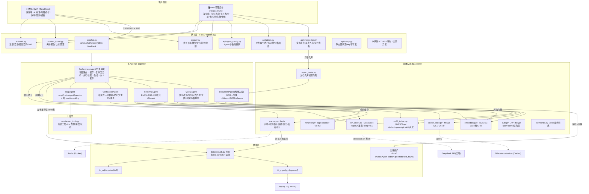
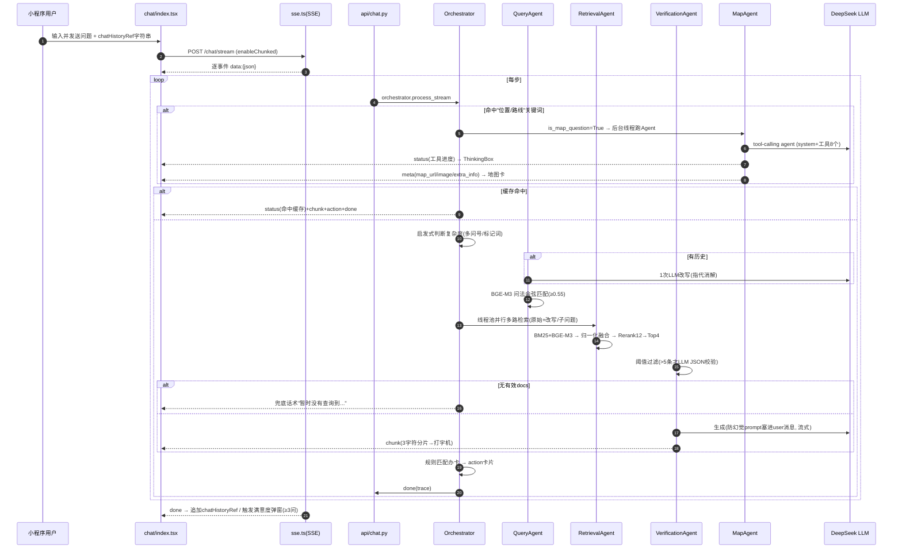

# 🎢 游乐场智能 RAG 问答系统 — 代码知识图谱与架构分析报告

> 生成时间：基于仓库当前主干（commit d6ba4b9「新增语音、地图功能」前后）逐文件审阅
> 审阅范围：后端 `main.py / config.py / agents/* / api/* / core/* / tools/* / database/* / data_pipeline.py / bench_*`，前端 `miniprogram/*`（Taro 小程序）与 `code/*`（React Web 管理端），基础组件 `docker-compose.yml / requirements.txt / *.sql`

---

## 1. 系统全景（一图看懂）



### 一句话架构概括

> **"多 Agent 命名下的 RAG 流水线 + 一个真 Agent(地图) + 一整套围绕票务/失物/签到的业务闭环"**
> FastAPI 网关把「微信小程序游客端」与「React 运营后台」接到同一套后端：对话主链路由 Orchestrator 按固定管线编排 Query/Retrieval/Verification 三个"伪 Agent"（LLM 只作文本子程序），唯独 MapAgent 用 LangChain `create_tool_calling_agent` 做了真实 function calling；另有一个与对话无关的 DocumentAgent 负责知识入库。业务（办卡/支付/签到/失物）走独立 REST 接口，聊天中通过 `action`/`meta` 事件插入卡片与地图，形成"边聊边办"的半闭环体验。

---

## 2. 模块拆解与联系（按层）

### 2.1 依赖关系全景（后端 import 拓扑，人工梳理+代码核对）

```
main.py(FastAPI网关)
 ├─ api/chat.py → agents.query_agent / agents.orchestrator / core.auth / core.cache
 ├─ api/knowledge.py → agents.document_agent / core.async_tasks / core.cache / agents.query_agent(reload)
 ├─ api/admin.py → core.auth / database.db / core.cache / core.vector_store / core.bm25_index
 ├─ api/agent_config.py → core.auth / config / agents.retrieval_agent
 ├─ api/auth.py → core.auth / database.db
 ├─ api/amap.py → config(AMAP key)  ※前端静态图代理
 ├─ api/pay.py → core.auth / database.db / config
 ├─ api/lost_found.py → core.auth / database.db / config(静态目录)
 ├─ core.vector_store(Milvus) → core.embedding
 ├─ core.bm25_index → core.keywords / config
 ├─ core.cache(Redis) → core.keywords / database.db(日志落库)
 ├─ core.async_tasks(线程队列,无外部依赖)
 └─ agents.orchestrator
     ├─ agents.query_agent → core.llm_client / core.embedding(问法库) / config / chunks文件
     ├─ agents.retrieval_agent → core.embedding / core.vector_store / core.bm25_index / core.reranker / core.cache
     ├─ agents.verification_agent → core.llm_client
     ├─ agents.map_agent → tools.amap_tools / langchain_openai / config
     └─ database.db(cards表 → 办卡推荐)
 agents.document_agent → paddleocr / langchain_text_splitters / core.embedding / core.vector_store / core.bm25_index
 tools.amap_tools → requests / langchain_core.tools / config / core.cache(配额计数)
```

### 2.2 各层要点表

| 模块 | 文件 | 职责 | 与其它模块的关键耦合 |
|---|---|---|---|
| **入口** | `main.py` | 注册全部路由/中间件/启动任务(建库、异步线程、BM25恢复、模型预热) | 汇总一切；启动期依赖 core.* 与 agents.* |
| **配置** | `config.py` | 全部静态配置 + .env 注入 | 被**模块级 import 时值拷贝**引用（多处只生效于 import 时刻） |
| **调度 Agent** | `agents/orchestrator.py` | 编排整条对话管线、缓存、办卡推荐、降级 | 懒加载 4 个 agent；并发线程池调检索 |
| **Query Agent** | `agents/query_agent.py` | 改写/问法映射/意图/问候/档位应答 | 无历史时不调LLM；有历史时1次LLM；问法库来自 chunks 文件 |
| **检索 Agent** | `agents/retrieval_agent.py` | 混合检索+融合+Rerank+阈值 | 无LLM，全本地模型 |
| **校验 Agent** | `agents/verification_agent.py` | LLM相关性校验+防幻觉生成 | verify>5条才调LLM；生成把规则拼进 user 消息 |
| **地图 Agent** | `agents/map_agent.py` | 意图预判+AgentExecutor 工具调用+降级 | 唯一真system提示词+function calling |
| **文档 Agent** | `agents/document_agent.py` | OCR/解析/分块/入库/删除 | 离线；只被 knowledge API 调用 |
| **LLM** | `core/llm_client.py` | DeepSeek 同步/流式调用 | 全仓统一出口，但 system 形参无人使用 |
| **检索核心** | `core/{embedding,vector_store,bm25_index,reranker}.py` | 向量/BM25/重排 | embedding 本地 CPU 加载重(57s冷启已做预热) |
| **缓存/会话** | `core/cache.py` | Redis 单例：答案/检索缓存、频控、日志、统计 | 会话 save_history **没有写入方** |
| **鉴权** | `core/auth.py` | JWT(bcrypt) user/admin | 与 api/auth.py(微信) 协作 |
| **异步** | `core/async_tasks.py` | 单 worker 线程队列处理入库 | 无持久化、无多worker |
| **数据** | `database/db.py` | 驱动代理 | 按 DB_DRIVER 导入 mysql 或 sqlite 全量函数 |
| **数据实现** | `db_mysql.py / db_sqlite.py` | 各自 ~1400 行同构函数集 | **双份大段重复**(60KB/55KB) |
| **地图工具** | `tools/amap_tools.py` | 8 个高德@tool+配额/进度 | 全局单例状态(并发隐患) |
| **前端** | `miniprogram/` | 游客端全流程 | SSE自研解析、ThinkingBox/Markdown/CardAction |
| **前端** | `code/` | 纯运营后台(9页) | 遗留HomePage等为死代码 |

### 2.3 一图看清：一次对话的调用时序



---

## 3. 优点（值得保留的设计）

### 检索与防幻觉
1. **混合检索扎实**：BGE-M3(语义) + BM25+jieba+bigram(关键词) → min-max 归一化加权融合(alpha=0.6) → Rerank 截断优化(12条才进 CrossEncoder) → 阈值过滤，召回率评测 recall=0.9667 / precision=0.90（eval_report.json）。
2. **多路检索并行与去重保优**：`_merge_docs` 按文本去重且保留更高 rerank 分版本，明确注释了防"先到先得丢高分"的坑；线程池把多路改写/检索延迟压到接近单路。
3. **防幻觉约束到位**：系统规则明确"无资料即拒答"、结尾【来源文档】、评测 hallucination_rate=0.0、token_hit_rate=0.8627。
4. **容灾完善**：BM25 pickle 本地持久化 + 启动可从 Milvus 重建（不依赖 Milvus 存活）；向量库 5s 超时快速失败降级 BM25；Redis 不可用时自动跳过缓存/频控放行。
5. **检索/答案两级 Redis 缓存** + 关键词归一化 key（jieba 分词语义归并），缓存命中即时返回并仍补办卡推荐。

### 工程健壮性
6. **SSE 链路防护双保险**：生成器内 `_safe_next` 包装 + API 层 try 兜底，任何异常都转为 `error` 事件而不静默断流；结束统一补 `trace` 事件。
7. **启动预热**：后台线程预热 embedding/reranker/检索管道，把首次提问 57s 冷启动压到 ~8s。
8. **降级链完备**：地图 Agent(配额/超时/异常/未用工具)→fallback 走 RAG 文本；LLM 改写/校验失败都回退原文/前几条，不阻断主流程。
9. **知识库变更联动**：入库/删除后 flush 缓存 + 重载常见问法库（query_agent.reload_patterns），保持一问一答时效性。
10. **安全基线**：API Key 全部走 .env 注入；JWT 未配置时生成随机密钥并告警；高德 key 不下发前端(走代理)；办卡金额以 cards 表权威为准、订单幂等；失物照片静态托管。

### 前端体验与业务闭环
11. **小程序对话体验成熟**：流式打字、思考时间线(ThinkingBox)、Markdown 渲染、地图静态图+导航、POI/路线/天气信息卡、办卡 action 卡片一键下单、语音输入、断网预检、SSE 超时看门狗(首包30s/空闲45s/整体180s)、UTF-8 截断字节拼接等细节非常到位。
12. **SSE 降级策略聪明**：流式失败 → 降级 POST /chat 一次性接口；已有部分内容则"保留已收文本仅结束"，不重复弹错。
13. **后端与双端契约统一**：`{code,data,msg}` + FastAPI detail + 分页 `page/page_size/total/pages/items` + Bearer JWT，管理端 9 页职责清晰。
14. **运营可观测闭环**：问答日志(Redis热+MySQL持久) + 意图分布/TOP问题/日趋势/满意度评分 + ECharts 四图，为迭代提供数据。

---

## 4. 缺点与隐患（按严重度）

### A 类：会让"AI 显得不聪明 / 不 Agent"的核心问题
1. **"Agent"名不副实（除地图外）**：Orchestrator→Query/Retrieval/Verification 是**固定线性流水线**，判断全靠关键词/阈值/余弦相似度，没有 LLM 规划、反思、多轮自我修正循环；`evaluate_answer_quality / trace_sources` 等评估能力写了却从未调用。
2. **单模型单点 + 无参数细调**：所有环节(改写/拆分/校验/生成)都走同一个 DeepSeek，temperature 固定 0.1；无 top_p/max_tokens/stop；无第二模型 failover；无按任务选模型(fast/slow)。
3. **没有真正的 system 角色**：RAG 主链路的"防幻觉规则 + 资料 + 问题"全部拼进一个 user 消息；llm_client 的 `system` 形参全仓无人传（仅 MapAgent 用了 ChatPromptTemplate 的 system）。这让模型对"角色/规则"的服从性打折。
4. **会话记忆形同虚设**：后端 Redis 有 `session` 存储 API 却**没有写入方**（save_history 只在"清空"时被调用）；真实记忆=前端每轮自拼的纯文本字符串，无结构化、无 token 预算、无摘要压缩、服务端重启即丢；`chat_sessions/chat_messages` 两张表+全套 CRUD 是**死表/死代码**。
5. **"思考过程"是假过程**：SSE 无 reasoning 事件，前端 ThinkingBox 展示的全是后端预置文案(🔍/📡/🎯/🤖)与地图工具进度，用户看到的是"进度提示"而非"真实思考/规划轨迹"。
6. **检索决策不智能**：无"该不该查知识库/该查哪类库"的 LLM 判断——问候与档位问句靠两条死规则短路，其余一律全量检索；结构型/实时型问题（天气、价格、余额、排队、我的卡）与文档型问题混在同一条 RAG 通道里。
7. **工具面太窄**：除高德 8 个工具外没有其它工具——大量**后端已有能力没有接入对话**：查我的余额/持卡(pay)、失物查询/报失(lost_found)、签到、卡产品库(cards)、SQL结构化查询等，都能做成 function calling 让模型自主调用，但目前只有"答案文本里规则匹配 → 办卡卡片"一个动作出口。

### B 类：明确的 Bug / 逻辑问题
8. **交易安全：发卡与置 paid 分两次提交**：mock 支付(pay.py:141-143)与微信回调(284-289)都是"先 update 订单 paid、再 add_user_card"两次独立 commit，中途崩溃=已付费无卡；回调并发为"读-判-写"TOCTOU，且 `user_cards.order_no` **无唯一索引**（两份 schema 都没有 uk），重复通知可重复发卡。
9. **Redis 挂掉会连 DB 日志一起丢**：core/cache.py:260-261 `if not self.available: return` 在最外层，问答日志的 **DB 落库被错误嵌在 Redis 可用性判断之内**（save_question_log 双写全失效）。
10. **支付开关语义与注释矛盾**：`WECHAT_PAY_ENABLED` 默认 false（config.py:96 注释应返回 4001"未开通"），但 `_pay_mode()`(pay.py:36-39) 把除 "true" 外一律当 mock → **线上误设 false 会免付费直接发卡**；微信回调验签/解密仍是 TODO(265-269)。
11. **"参数热更新"多数不生效**：`/config/agent` 把 top_k/rerank_top/similarity_threshold/llm_temperature/chunk_size/chunk_overlap 写进 `_runtime_config`，**全仓无消费方**；只有 hybrid_alpha 真正生效。管理端 UI 显示"已更新"实际无效（误导运营）。
12. **chunk_overlap 改错常量**：实际切块用 `TOKEN_OVERLAP`，配置 API 更新 `CHUNK_OVERLAP`——改了个不被消费的变量。
13. **地图全局状态并发串扰**：`amap_state` / `_progress_cb` 是模块级单例，多用户并发地图请求时资源/进度互相覆盖，甚至把上一请求的 map_url 带给下一请求（应改 contextvars 按请求隔离）。
14. **缓存与个性化冲突**：地图成功分支写了答案缓存却从不读缓存（无效写）；"怎么去/多远"这类**依赖出发点的答案按问题原文缓存**，会向不同用户返回他人起点算出的路线结果。
15. **无断连取消**：SSE 断开后地图后台线程与 LLM 调用继续跑完，浪费 token 与高德配额；前端 `sseTaskRef.abort()` 已实现却**没有"停止生成"按钮**。
16. **Redis 统计写无异常保护**：`incr_counter/get_counter` 在 Redis 掉线时会抛异常，chat.py 统计段未 try，可能在回答已完成时仍返回 500。
17. **检索缓存无失效联动**：删文档/重入库不清 `cache_search` 的键，旧问句可能短期返回已删除内容。
18. **复杂性拆分按字面 split("?")**：英文/URL 问句被误拆成多个"子问题"。
19. **缓存 key 有语义碰撞风险**：答案/检索缓存 key 基于 jieba 关键词排序拼接（cache.py:77-106），语义不同但关键词相同的问题（如"门票多少钱"vs"门票包含什么"）可能共享 key 串答；且带历史改写后的问句命中率低。

### C 类：工程 / 代码卫生
20. **双数据库实现大段重复**：db_mysql.py(~1580行) 与 db_sqlite.py(~1416行) 函数集完全同构（连文档字符串都逐行一致），唯一 API 差异是 sqlite 独有的 get_card_by_name；改一处忘另一处必出 bug（建议单 SQL 抽象层或 SQLAlchemy/统一方言）。schema 还有 4 份副本（两份 .sql + 两份 init_db 内嵌）且 .sql 已过期（缺 user_checkins、question_logs.intent、user_cards.coins、lost_found_items 等）。
21. **六张表是运行时死代码**：chat_sessions/chat_messages、documents/document_chunks、agent_config、operation_logs 仅 test 脚本调用；会话实际走 Redis、知识库索引实际走 文件+Milvus+BM25、热配置实际用进程内 dict、文档状态不落 DB。
22. **死代码多**：orchestrator.doc_agent 属性、expand_keywords、evaluate_answer_quality、trace_sources、Web 端 HomePage/ProfilePage/RegisterPage/localStorage 假认证、AGENTS.md(还在描述原型需求)、`code/src/data/*` mock、web SSE 旧解析等。
23. **前端双份 SSE 解析已漂移**：PC HomePage(遗留) 与小程序 sse.ts 各写一套，PC 版不处理 done/action、无降级保留部分，聊天逻辑在两端重复维护。
24. **小程序 chat 页 896 行巨型组件**：对话+5弹窗+失物+满意度+语音全在一个文件；无状态管理库、messages 只存内存切页即丢。
25. **无并发/事务纵深**：async_tasks 单 worker 无持久化、失败无重试队列；async 端点内直接跑同步 DB/Redis/embedding/LLM 阻塞事件循环（仅 chat/stream 用 run_in_executor）；sqlite 无 busy_timeout、MySQL 无连接池且多函数异常路径不 close；发卡"置 paid+add_user_card"无单事务与唯一索引；上传整文件进内存(≤50MB×并发)、入库失败不回滚不重试。
26. **评测自证闭环**：bench_eval.py 的测试集从 chunks 自带"**常见问法**"行生成，与 QueryAgent 问法库同源——recall 0.97/幻觉 0 属于"答自己出的卷子"，不能代表真实泛化；且未纳入 CI/管理端。
27. **README 过时**：还写 qwen-max/LangChain/index.html(已删)/rag_chain.py(已删)/vector_store.py(已移 core/)，与新架构不符，容易误导新成员。
28. **分块实现三处重复且漂移**：document_agent.py:66-121 / data_pipeline.py:24-77 / bench_chunking.py:151-214 各一份；每 chunk 重复携带 H1/H2 标题前缀(浪费 token)；`.doc` 扩展名声明支持但 process_document 无对应分支(L136-138)。

---

## 5. 优化建议（分级落地）

### P0 — 不改变架构、改动小、立刻提升"智能感 / Agent感"
| # | 动作 | 改哪 | 收益 |
|---|---|---|---|
| 0 | **交易安全优先**：给 user_cards 加 UNIQUE(order_no)，把"置 paid+发卡"包进单事务/CAS(UPDATE…WHERE status='pending')；`WECHAT_PAY_ENABLED` 语义与 _pay_mode 对齐(未开通返回4001，仅 mock 联调模式可白卡)；微信回调验签解密补全 | database 两份 schema/init_db、api/pay.py | 不白送卡、不重复发卡 |
| 0.5 | **日志落库与 Redis 解耦**：save_question_log 拆为"Redis 热写可选 + DB 必写"，去掉 cache.py:260-261 的外层可用性判断 | core/cache.py | Redis 宕机不丢运营数据 |
| 1 | **让"热更新"真正生效**：检索/LLM参数改为每次读取的运行时配置对象（参照 hybrid_alpha 的 setter 模式），删掉无消费方代码 | api/agent_config.py, agents/retrieval_agent.py, core/llm_client.py | 消除"看似能调实际无效"的误导 |
| 2 | **正确使用 system 角色**：RAG 生成/改写改用 ChatPromptTemplate(system=防幻觉规则, user=问题, 引用结构注入)；结束流再单独发"来源"事件 | agents/verification_agent.py, query_agent.py, core/llm_client.py | 规则服从性↑，回答更"懂角色" |
| 3 | **后端接管会话记忆**：前端把 session_id 传后端，服务端按 user 增量存 messages(启用现成 chat_messages 表)，请求构造最近N轮结构化 history + 超长滚动摘要 | api/chat.py, core/cache.py或database.db, miniprogram chat | 多轮指代/连续性显著提升，这是"聪明感"的第一来源 |
| 4 | **加"停止生成"**：SSE 生成器检测 `request.is_disconnected` / 前端 abort 传取消令牌，后端中断 LLM 流与地图线程 | api/chat.py, orchestrator.py, map_agent.py, chat/index.tsx | 控制感↑、省 token |
| 5 | **结构化 process 轨迹**：把 status/debug 文案升级为结构化事件 `{type:"step", step:{phase,tool?,detail?,elapsed?}}` 并打通前端已预留的 `trace` 事件渲染"图标化步骤时间线" | orchestrator.py, chat.py, miniprogram ThinkingBox/sse.ts | 让用户"看见"检索/重排/工具调用过程=Agent感核心 |
| 6 | **修复地图状态并发**：amap_state/progress_cb 改 contextvars/请求级对象 | tools/amap_tools.py, agents/map_agent.py | 多用户正确性 |
| 7 | **修 Bug 清单**：缓存与地图分支读写一致性、检索缓存失效联动、缓存key碰撞(语义归并可保留但加后缀去重/归一)、Redis 统计异常保护、拆"?"逻辑、删死代码 | 对应文件 | 稳定性 |

### P1 — 中等改造，把"对话能力"升维成"Agent 能力"
1. **工具化(把现有后端能力变成可调用的 function calling 工具)**，例如：
   - `查卡产品(在售卡/价格)`、`查我的余额/持卡/签到状态(需鉴权token注入)`、`查失物/报失(需确认)`、`天气/地图`(已有)、`SQL直查结构化数据(设施身高限制/营业时间等)`；
   - 用 `create_tool_calling_agent` 同款范式（代码里已有完整先例=MapAgent），把"用户→工具规划→执行→整理"给主对话；系统提示词列举工具+何时用+何时拒绝。
2. **意图路由(Intent Router)**：在 Orchestrator 前加一次轻量 LLM 分类或高质量小模型/规则混合路由：`{ticket_purchase, balance, navigation, lost_found, policy_qa, chit_chat, …}`，不同意图走不同管线（结构化查库 / RAG / 工具Agent / 固定话术），避免"所有问题都当文档检索"。
3. **行动闭环(action 协议通用化)**：现在只有"办卡推荐"一种 action 卡片。把 SSE 事件扩展为通用动作清单：导航、看余额、签到、报失表单、一键充值、二次确认(高风险动作) —— 后端下发 `{type:"action", actions:[{id,kind,payload,confirm?}]}`，前端卡片组件化渲染。
4. **可点击引用与正文标注**：meta 携带 doc_id+来源摘要，回答正文用 `[1]` 锚点与来源一一对应（真实引用注入，替代"模型猜来源"），前端点击看原文/追问。
5. **检索决策化+二次检索兜底**：生成时若模型判断资料不足(或置信低)，自动发起第二轮改写检索再生成；把 verify 阈值后的空结果路由到"猜你想问的快捷问题/主动澄清"而非硬邦邦的兜底话术。
6. **SSE 增加 reasoning/延迟可见性**：在等待检索时可选先发部分思考(如改写结果"我理解您在问X，正在查…")，让等待期"有思想"。
7. **离线结构化知识**：把游乐设施/票价/身高限制/营业时间从文档里抽成结构化表(现有 cards 表即范例)，问答命中时直查库而非靠 chunk 文本拼凑——对"票价多少钱"这类问题从"检索拼句"变成"数据查询+组织"，确定性大增。
8. **检索算法精细化**：融合改为跨查询可比的分位归一或RRF，避免"每查询相对 min-max"在小知识库失真；统一 0.45(检索)/0.3(校验)双阈值语义；去掉无命中时"硬塞低质上下文"的兜底(改为"资料不足+主动澄清"分支)；Milvus schema 增加文档级元数据字段(分类/更新日期/状态)支持过滤(如下架文档不召回)；分块去重标题前缀、统一三处重复的分块实现。
9. **性能专项**：query 向量加 Redis/内存缓存(同 query 多会话命中)；embedding/rerank 改异步+批处理或 GPU；async 端点内的同步 DB/Redis 改 run_in_executor 或异步驱动，避免阻塞事件循环。

### P2 — 架构级演进（"强大 Agent"路线图）
1. **从"1个真Agent"到"编排器+多技能Agent"**：主对话用一个 Super-Agent（工具调用式），把 RAG 检索、地图、业务查询、办卡都注册为工具；LLM 自主规划步数（框架内可 max_iterations+return_intermediate_steps 已有配置先例），Orchestrator 退化为"安全阀/降级器"。
2. **规划-执行-反思循环**：复杂任务先出计划(Plan)→并行执行→自评答案质量(evaluate_answer_quality 复活!)→不满则二轮修正；把已写未用的评估函数接回主链路。
3. **多轮记忆产品化**：会话列表(新建/历史/标题)、长期用户画像(孩子身高/常去设施/偏好→个性化推荐与提醒)、token 预算与摘要；`chat_sessions/chat_messages` 表正式启用。
4. **端到端评测平台**：把 bench_*.py 升级为"管理端一键评测"（自动问答集+人工打标+幻觉/命中/延迟看板），每次知识库/参数变更跑回归。
5. **模型编排**：便宜快模型做改写/意图/轻校验，强模型做最终生成与复杂规划；可配 temperature/max_tokens/stop 分段参数；预留多供应商 failover。
6. **多模态**：图片提问（拍价目表/设备故障照片→OCR+VQA）、语音 TTS 朗读；小程序已具备语音入口与拍照上传基础。
7. **重活异步化与基础设施**：入库任务队列持久化、多worker；检索/生成可观测(OpenTelemetry)；日志分级；CI 接入 lint+typecheck+单测+评测。

### 成本/性能专项
- embedding/reranker 本地 CPU：多用户并发时单请求 ~5s(评测 p95=5.27s)。可考虑 GPU 部署或替换 API embedding；至少做 query 向量缓存与 embedding 批处理复用。
- Redis/MySQL/Milvus 已 Docker 化：建议加日志与指标采集(Grafana 可选)；Redis 需按 admin 的 /cache/clear(flushdb) 收紧为只清 rag:* 前缀，避免误清同 DB 其它键与统计。
- 会话与日志写库放异步/批量，避免每问一写阻塞。

---

## 6. 重点：怎么让用户"感受到 Agent 的强大"（产品视角）

> 用户觉得"模型单调、不智能" = 现在对话只做一件事：**把你的一句话，翻译成一次文档检索，然后念一段文档**。它没有"想"、没有"查"、没有"做"，也没有"记得你"。

让用户感到强大的四个杠杆（按性价比排序）：

### 杠杆1：让"看不见的步骤"变成"看得见的过程"（改动最小、感知最强）
- 现在 ThinkingBox 只有"🔍正在分析…📡检索中…🤖生成中"三段废话。
- 改为**真实的步骤时间线**：`我理解您在问「从三元桥怎么到大黄鸭游乐园」→ 正在定位出发地…→ 高德路线规划返回：驾车 28.6km / 约47分钟 → 正在整理回答`；RAG 问句则展示 `改写：门票多少钱 → 检索问句「票价价格」`、`BM25 命中2篇 / 向量命中3篇`、`精排后保留4段`。
- 前端把这些渲染成可折叠的"思考轨迹"卡片（icon+阶段+耗时+可展开原文），Agent感立刻出现——这正是 ChatGPT/Manus 类产品打动用户的机制：**透明 = 强大**。

### 杠杆2：从"答一句"到"办一件事"
- 现在用户问"怎么办卡"只得到一段话+被动卡片。
- 升级：问"我想给孩子办个卡，余额能用在过山车吗" → Agent 自动查卡产品与用卡规则，给出推荐并 `action` 一键下单；问"我丢了个粉色水壶" → Agent 查询失物库，有则推送认领入口，没有则引导填写报失表单（照片上传）。每多一个"能办事"的动作出口，用户感知的"能力边界"就扩大一分。

### 杠杆3：让 AI "记得你"并主动
- 服务端会话存储 + 用户画像（上轮在问多高孩子能玩过山车→这轮说"那能玩旋转木马吗"能直接指代+给出身高建议）；开场按画像给个性化建议（雨天问天气主动提醒"今日小雨，室内项目推荐…"）。
- 回答完主动给 1-3 个**依据当前上下文生成**的追问（而不是前端写死的 6 个快捷问题），引导多轮深聊。

### 杠杆4：多模态与"真·会思考"的呈现
- 图片/语音已具备基础：把图片问答、TTS、拍照报失做成 Agent 技能。
- 对复杂问题展示"我先分三步帮您梳理"的计划卡片，逐步执行并汇报——这比一次性长篇回答更显"规划力"。

### 落地优先级（约 2-3 周可完成的首批组合）
```
第1周：P0#2(真system) + P0#3(服务端会话记忆) + P0#5(结构化步骤事件+前端时间线) + P0#4(停止生成)
第2周：P1#1(业务工具化: 余额/卡/失物/签到 function calling) + P1#2(意图路由) + P1#7(设施结构化表直查)
第3周：P1#3(通用action协议+办卡/导航/报失卡) + P1#4(可点击引用) + 评估面板跑通
```

---

## 7. 附：本次审阅发现的"低垂果实"Bug速查

| 位置 | 问题 |
|---|---|
| api/pay.py:141-143,281-289 + 两份schema | mock/回调"置paid+发卡"两次commit无事务，user_cards.order_no 无唯一索引→并发重复发卡 |
| api/pay.py:36-39 vs config.py:93-96 | 支付开关 false 实际等同 mock（免付费白卡），与注释"返回4001"矛盾 |
| core/cache.py:260-261 | Redis 不可用时问答日志连 DB 落库一起丢失（落库被嵌在 Redis 可用性判断内） |
| api/pay.py:265-269 | 微信回调验签/解密为 TODO（resource.plaintext 直读） |
| api/agent_config.py:66-93 | 热更新参数无消费方(仅 hybrid_alpha 生效) |
| agents/document_agent.py:104 vs config.py:48 | 配置改 CHUNK_OVERLAP 但切块用 TOKEN_OVERLAP |
| agents/document_agent.py:136-138 vs :21 | 支持 .doc 声明但 process_document 无 .doc 分支 |
| data_pipeline.py + bench_chunking.py + document_agent.py | 分块逻辑三处重复且已漂移；每chunk重复标题前缀费token |
| tools/amap_tools.py(amap_state/_progress_cb) | 模块级单例，并发地图请求互相串扰 |
| agents/orchestrator.py:406-423 | 地图成功分支不推 action 办卡卡(与RAG分支不一致) |
| agents/orchestrator.py:421+428 | 地图分支写缓存但从不读缓存(无效写) |
| agents/verification_agent.py:114/130 | references 形参未注入 prompt，来源靠模型猜 |
| agents/verification_agent.py:135/162 | 答案质量评估/溯源函数从未被调用 |
| api/chat.py:66-76 / core/cache.py:194-207 | Redis 掉线时统计调用无异常保护可能致500 |
| api/knowledge.py(入库/删除) | 不清检索缓存键，旧问句可能返回已删文档 |
| core/cache.py:77-106 | 答案/检索缓存 key 基于关键词拼接，语义不同问题可能同 key 串答 |
| agents/orchestrator.py:104-106 | 含英文问号按字面 split("?") 误拆问题 |
| agents/retrieval_agent.py:73-78 | 无命中时"硬塞 top_k 低质上下文"兜底，与防幻觉目标相悖 |
| bench_eval.py:15-53 | 测试集从KB自带"常见问法"自证生成，与问法库同源→评测过拟合 |
| database/(db_mysql.py + db_sqlite.py) | ~3000行同构双实现，schema 4份副本，.sql 已过期 |
| database/(chat_sessions 等6表) | 会话/消息/文档/agent_config/operation_logs 运行时死表 |
| main.py:101 / 根目录 | 首页 FileResponse("index.html") 但 index.html 已被删除 |
| miniprogram chat/index.tsx | abort 已实现但无"停止生成"按钮；messages 仅存内存 |
| code/src(HomePage/Profile/useAuth/data) | localStorage 假认证游客端为死代码，与真后台并存 |
| README.md | 描述 qwen-max/rag_chain.py/index.html 等已不存在的旧架构 |

---

*本报告由代码逐文件审阅 + 4 路并行子分析汇总而成；行号基于当前工作区快照。*
