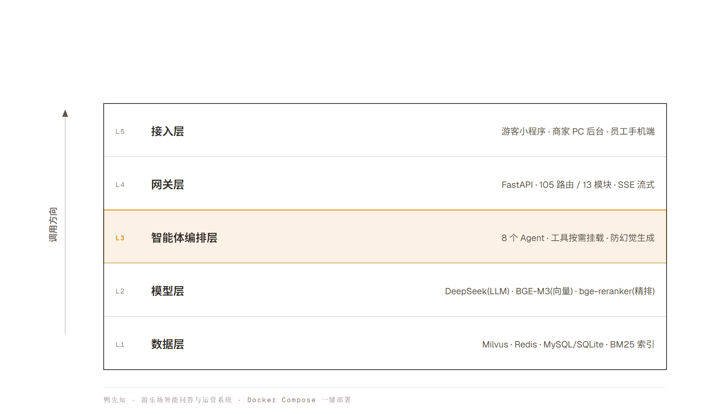
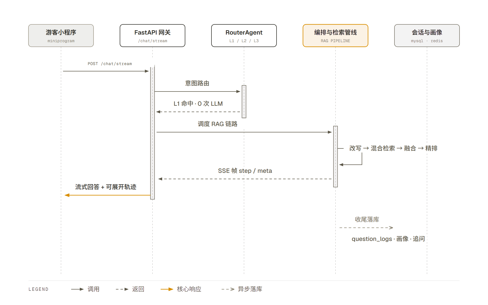
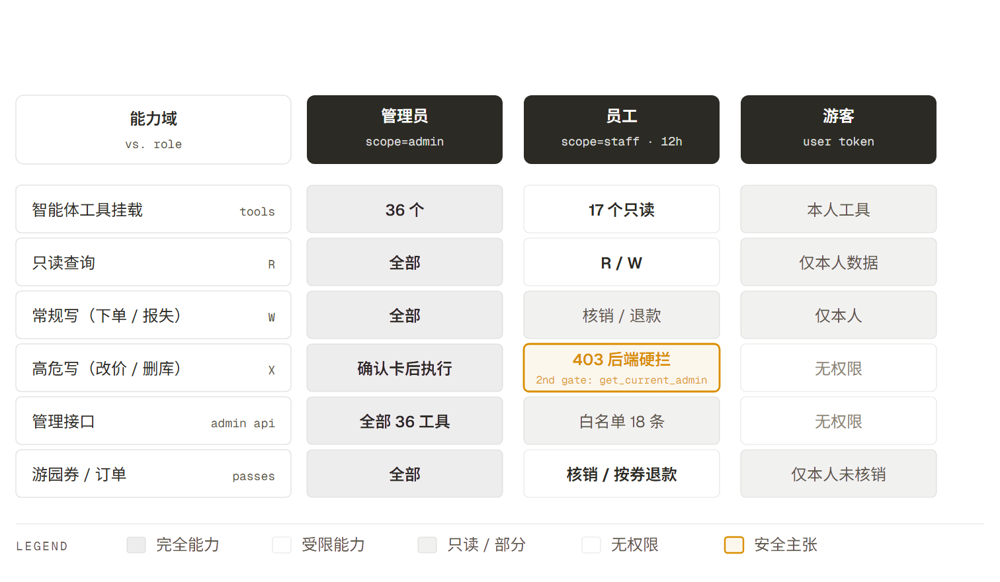
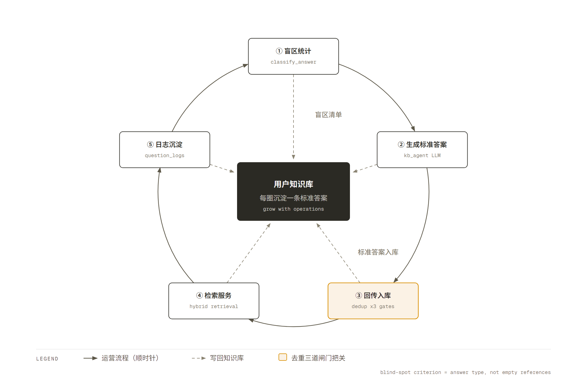
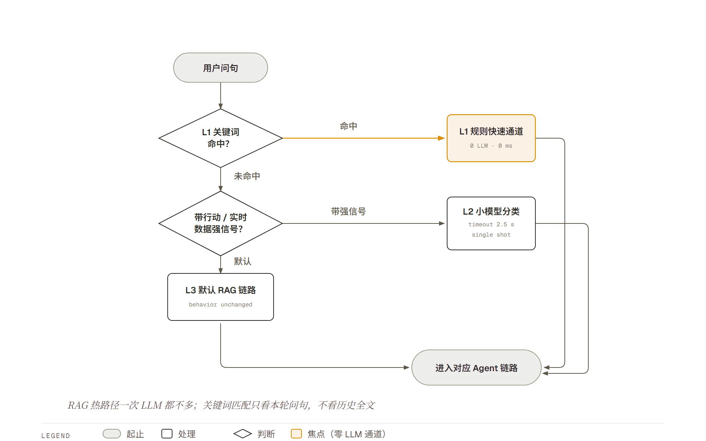
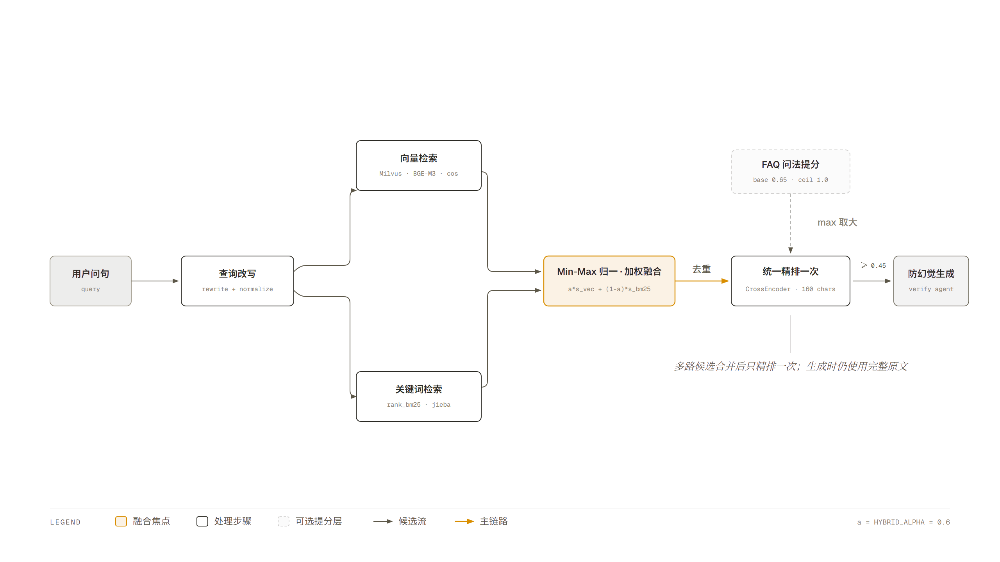
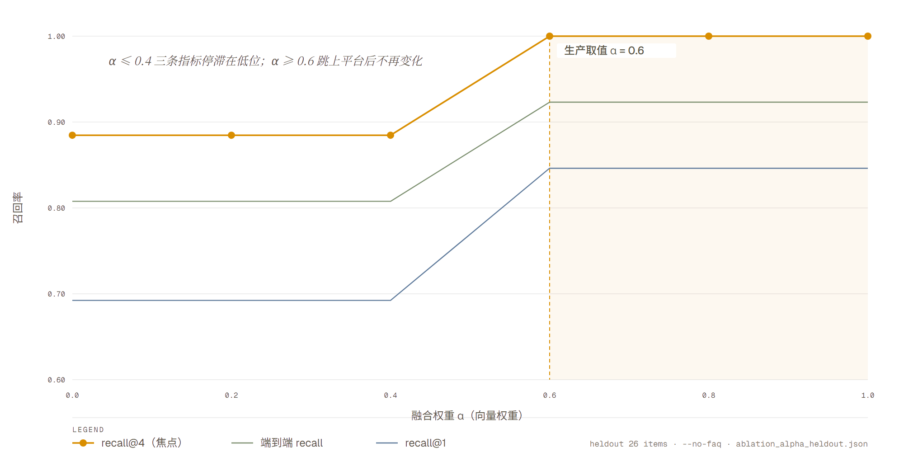
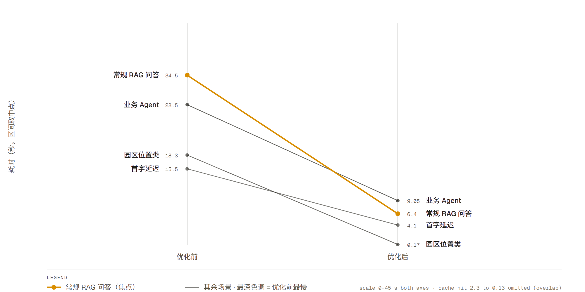

# 鸭先知 · 游乐场智能问答与运营系统

## 技术方案书

**参赛赛道**：AI+软件创新（算法创新赛道）
**软件名称**：游乐场智能问答与服务系统（登记名）
**产品名**：鸭先知
**版本**：v1.0
**编制日期**：2026 年 9 月

---

## 一、产品概述与定位

### 1.1 背景与目标

#### 1.1.1 行业背景与市场痛点

我国游乐园行业呈现明显的"哑铃型"结构：头部园区已完成智慧化改造，中小园区仍停留在人工窗口与纸质券阶段。中小园区的共性问题集中在两端：

**游客侧——"问不到、问不准、问完还得自己跑"**

| 痛点 | 具体表现 |
|---|---|
| 问不到 | 非营业时段无人应答；现场窗口排队；电话占线 |
| 问不准 | 票价规则、儿童限高、退卡政策等信息分散在纸质告示与老员工记忆里，口径不一致 |
| 问完还得自己跑 | 想知道"卡里还剩多少钱""东西丢在哪了",即便问到了答案，后续动作仍要跑到窗口 |

**运营侧——人力成本刚性，服务时段与质量都不可控**

园区客服是典型的人力密集型岗位：旺季必须加人，淡季闲置；培训成本高且流失率大；服务质量随人而变，管理层缺少可量化的洞察（游客到底在问什么、哪类问题答不上来）。

#### 1.1.2 产品目标与研发意义

本产品面向中小游乐园，目标是构建一套**从"回答"升级为"办成事"**的园区智能服务与运营系统：

- **对游客**：在微信小程序里问一句，AI 不只念文档，而是**真实地**查余额、查失物库、算"剩 120 币能玩什么"、推荐办卡并直接下单；
- **对园区**：把重复咨询交给 AI，把"答不上来的问题"自动沉淀为知识库资产，形成**运营闭环**；
- **对行业**：验证"多智能体 + 检索增强生成（RAG）"在文旅场景的低成本落地范式——全部组件可离线私有化部署，不依赖特定云厂商。

### 1.2 产品定位

#### 1.2.1 产品类型与目标用户

| 维度 | 说明 |
|---|---|
| 产品类型 | AI 赋能软件（多智能体智能客服 + 门店数字化运营系统），含在线服务形态 |
| 交付形态 | 微信小程序（游客端）＋ Web 管理后台（商家端）＋ 手机端降权页（员工端）＋ FastAPI 后端 |
| 目标用户 1 | **游客**：入园前咨询、园中求助、离园后售后 |
| 目标用户 2 | **园区运营人员**：知识库维护、数据看板、卡产品与账单管理 |
| 目标用户 3 | **现场员工**：扫码核销、按券退款、失物登记、现场开卡 |

#### 1.2.2 核心功能与应用场景

| 场景 | 用户行为 | 系统响应 |
|---|---|---|
| 游前咨询 | "两个大人带三个孩子怎么买票划算" | 混合检索命中票务规则 → 防幻觉生成 → 给出组合建议并推送办卡卡片 |
| 游中求助 | "东西丢了怎么找回" | 失物模糊匹配工具 → 返回候选失物 → 引导报失登记 |
| 游中消费 | "帮我买 5 个荡秋千" | 工具调用下单 → 生成游园券与二维码 |
| 现场核销 | 员工扫游客券码 | 券优先/整单兜底查码 → 逐张核销 → 按券退款 |
| 运营提效 | 管理员说"统计近 7 天没答上来的问题并生成文档" | 知识库智能体四步闭环：统计盲区 → 生成标准答案 → 导出 Word → 回传入库 |
| 经营分析 | 管理员说"今日营收汇总" | 经营小助手直接调工具 → 返回数字卡 + ECharts 图表 + 完整报告 |

#### 1.2.3 差异化优势

| 维度 | 本产品 | 行业常见做法 |
|---|---|---|
| **算法精度** | 混合检索（BM25 + 稠密向量）+ 交叉编码器精排 + 问法归一 + 四层防幻觉 | 单一向量检索或直接调大模型 |
| **运行效率** | **分级延迟**：规则快速通道 0 次 LLM（0.16~0.36s）→ 缓存命中 ~0.1s → 常规问答 4.7~8.1s | 每个问题都走完整 LLM 链路（数十秒） |
| **场景适配** | 工具族**真的能办事**（下单/退款/签到/失物/核销），AI 与按钮共用同一份业务核心 | 停留在"文本问答"，无法完成业务动作 |
| **可运维性** | 回答类型判定驱动的盲区自动挖掘 + 知识库去重三道闸门 | 靠人工整理 FAQ，脏数据与重复答案持续累积 |
| **可解释性** | SSE 逐步上抛**真实中间结果**（改写结果/各路召回数/精排保留数/耗时） | 黑盒返回，无法定位"为什么答错" |

---

## 二、技术架构与创新

### 2.1 整体架构

系统采用**分层 + 多智能体编排**架构，自下而上分为五层：



**模块间数据交互（一次游客问答的完整链路）**

1. 小程序携带 `session_id` 发起 `POST /chat/stream`；
2. `RouterAgent` 先走 L1 关键词表；未命中且问句带"行动/实时数据"标记才触发 L2 小模型分类（硬超时 1.5s）；否则默认 RAG；
3. 命中天气/地图/业务分支则走对应 Agent（业务 Agent 进入原生 tool-calling 循环，最多 2 轮 LLM 往返）；
4. RAG 分支：`QueryAgent` 改写并归一 → `RetrievalAgent` 并行取向量 + BM25 候选 → 分数融合 → 合并去重后**统一精排一次** → 阈值过滤 → `VerificationAgent` 生成；
5. 全程以 SSE 帧 `data: {json}\n\n` 上抛 `step / meta / chunk / action / suggestions / done / trace`；
6. 收尾：落 `question_logs`（含回答类型）→ 更新会话记忆与用户画像 → 生成主动追问。



### 2.2 技术选型依据

| 组件 | 选型 | 选型依据 |
|---|---|---|
| 嵌入模型 | **BGE-M3**（本地 CPU，1024 维） | 中文语义表现好；本地部署**零 API 成本、数据不出域**；1024 维在中小知识库上召回与存储成本平衡 |
| 倒排检索 | **rank_bm25 + jieba** | 专有名词、编号、价格等**字面精确匹配**是向量检索的弱项，BM25 与之互补；纯 Python 实现，pickle 持久化，无需额外服务 |
| 向量库 | **Milvus 2.4** | 支持元数据过滤与删除，便于"按来源清旧再入库"的幂等治理；IVF_FLAT + IP 索引在万级切片下延迟稳定 |
| 精排模型 | **bge-reranker-v2-m3**（CrossEncoder） | 交叉编码器精度显著高于双塔；仅对融合后的少量候选做精排，用**候选截断 + 文本截断（160 字）**把 CPU 开销压到可接受范围 |
| 大模型 | **DeepSeek**（OpenAI 兼容） | 原生 function-calling 支撑工具族；OpenAI 兼容协议便于更换供应商（见 3.3 扩展性）；**只用带日期快照的模型名**，避免无日期别名被静默重指版本或提前耗尽额度 |
| 数据库 | **MySQL 8 / SQLite 双实现** | 生产用 MySQL；开发与验收用 SQLite，可零依赖跑通全链路 |
| 缓存 | **Redis** | 问答/检索缓存、频控、热点问题配置、统计计数；连接复用 + 30s 失败冷却，缓存不可用不拖慢问答 |
| 前端 | 小程序 Taro4+React18；后台 React19+Vite+Tailwind | 小程序贴合游客使用习惯（微信内即用、免安装）；后台复用同一套 React 生态 |
| 部署 | **Docker Compose** | 一键拉起 Milvus/etcd/MinIO/Redis/MySQL **+ RAG 后端**，降低评审与交付门槛 |

### 2.3 创新应用

#### 创新点 1：从"回答"到"办成事"——AI 与业务共用同一份核心

AI 不是"念文档"，而是通过原生 function-calling 调用**真实业务工具**办事：
游客侧 **23 个工具**（园区业务 8 + 账户管家 9 + 服务工单 3 + 天气 1 + 消费 2），
商家侧 **36 个工具**（只读 17 / 常规写 11 / 高危 8）。

关键工程约束：**下单、扣币、退款全项目只有一份核心实现**（`services/purchase.py`、`database.refund_consumption_items`），
AI 调用与前端按钮点击走的是同一个函数。这避免了"AI 下单"与"按钮下单"两套逻辑漂移（价格算错、券数量对不上这类事故）。

#### 创新点 2：分级延迟——不是每个问题都值得走完整大模型链路

| 层级 | 触发条件 | 实测耗时 | LLM 调用 |
|---|---|---|---|
| 天气快速通道 | 纯天气问句 | **0.16~0.36s** | 0 次 |
| 问答缓存命中 | 命中原问题 | **0.04~0.13s** | 0 次 |
| L1 关键词路由 | 命中关键词表 | 0ms 新增 | 0 次 |
| 常规 RAG | 默认 | **4.7~8.1s** | 1 次生成（+1 次改写） |

优化前常规问答需 28~41s，缓存命中也要 2.3s。核心手法见 4.3.3。

#### 创新点 3：三角色权限模型 + 风险分档

同一套账号密码支撑三个角色，**降权在后端硬拦**而非前端不调用：

| 角色 | 令牌 | 能力边界 |
|---|---|---|
| 管理员 | `scope=admin` | 全部 36 个工具 |
| 员工 | `scope=staff`（12h） | **18 条白名单接口**；智能体只挂 **17 个只读工具**（36 → 17） |
| 游客 | 用户令牌 | 只能操作自己的数据（如只退本人未核销的券） |

工具按 `risk` 分三档：`R(read)` 直接执行、`W(write)` 直接执行、`X(danger)` 弹确认卡。
员工令牌额外在 `core.auth.get_current_admin` 里被第二道闸拦截（`scope == "staff"` → 403），
因为员工页的接口地址对使用者可见，**只靠前端不调用等于没有权限控制**。



#### 创新点 4：不编造——无资料时给确定性结论，而不是甩通用建议

知识库检索不到时，系统输出的不是"抱歉我不清楚"，而是**「园区资料已有信息 + 我能替你办的事」**，
首尾固定标注"非园区官方文档内容，以现场为准"，且绝不编造园区价格与规则。
该回答**不写入 Redis 问答缓存**，避免通用建议被当成知识库权威答案长期命中。

#### 创新点 5：回答类型判定驱动的盲区自动闭环

"没答上来"的判据是**回答类型**（`cached` / `fallback_none` / `fallback_partial` / `normal`），
而不是"引用列表为空"。这不是技术洁癖：早期用 `references_json` 为空当代理，7 天内 117 条里
有 **86 条是假阳性**——缓存命中的回答引用天然为空，而它其实是被高频问到的**正常回答**。

判据修正后，盲区统计 → 生成标准答案 → 导出 Word → 回传入库形成闭环，知识库随运营自动生长。



#### 创新点 6：可观测性——把"思考过程"变成产品能力

SSE 的 `step` 帧上抛**真实中间结果**（改写后的问题、向量/BM25 各路召回数、融合候选数、精排保留数、耗时），
小程序渲染为可展开的时间线。这既提升用户信任，也让运营方在答错时能定位到具体环节。

**对比同类产品的优势**

| 对比项 | 通用客服机器人 | 通用 RAG 问答 | 本产品 |
|---|---|---|---|
| 能否完成业务动作 | 否 | 否 | **是**（工具族 + 单一业务核心） |
| 是否防幻觉 | 弱 | 一般 | **四层**（强约束 Prompt + 相关性校验 + 阈值 + 兜底话术） |
| 是否可治脏数据 | 否 | 否 | **是**（去重三道闸门 + 盲区闭环） |
| 是否多角色 | 否 | 否 | **是**（管理员/员工/游客，后端硬拦） |
| 纯离线可部署 | 视实现 | 部分 | **是**（嵌入/精排本地，仅生成可换成本地模型） |

---

## 三、功能设计与实现

### 3.1 核心功能的 AI 实现方式

#### 3.1.1 三级意图路由（意图识别）

问题：意图识别若每次都调大模型，会给**每一次**问答增加一次 LLM 往返（实测 +0.85~1.75s）。

方案：三级瀑布式路由，**只有值得的路由才花钱**。



关键工程细节：**RAG 热路径一次 LLM 都不多**——普通知识问答不会触发 L2；
且路由的关键词匹配只看**本轮问句**，不看历史全文（否则聊过"天气/卡"之后任何问句都会被误抢）。

> ⚠️ 换文本模型必须同步复核 `ROUTER_TIMEOUT`：openai SDK 的 `timeout` 是**单次读超时**而非总耗时上限，
> 模型首字慢于该值就直接抛错、静默退化为纯关键词路由（不报错、不降级提示，极难察觉）。
> 实测 flash 首字 0.85s（1.5s 充裕）→ v4-pro 首字 1.23s 时，1.5s 会把请求 12/12 全部掐断；放宽到 2.5s 后 12/12 成功。

#### 3.1.2 混合检索与分数融合（核心算法）

单一检索方式各有盲区：向量检索对**专有名词与编号**不敏感，BM25 对**口语化改写**不敏感。
本系统采用分数级加权融合：



**第一步：各路召回**

- 向量路：`Milvus(IVF_FLAT, IP)` 检索 BGE-M3 嵌入，取 `VECTOR_CANDIDATE_K` 个候选；
- 关键词路：`rank_bm25 + jieba` 分词检索，取 `BM25_CANDIDATE_K` 个候选。

**第二步：分数级 Min-Max 归一化**

两路分数量纲不同（BM25 无上界，余弦相似度在 [0,1]），必须先归一化到同一尺度：

```
ŝ(x) = (s(x) − min S) / (max S − min S)         若 max S ≠ min S，否则全置 1.0
```

**第三步：加权融合**

```
score(d) = α · ŝ_vec(d) + (1 − α) · ŝ_bm25(d)
```

同一文本在两路都出现时取融合后的**较大值**去重。`α` 为向量权重（0=纯关键词，1=纯语义），
当前生产取值 `HYBRID_ALPHA = 0.6`（语义优先），并支持运行时热更新。

**第四步：精排（Rerank）**

融合候选**合并去重后统一送一次** CrossEncoder（bge-reranker-v2-m3）精排，
避免多路各自精排造成的重复计算与 CPU 争抢。精排按 `RERANK_DOC_MAX_CHARS=160` 截断原文，
但**生成时仍使用完整原文**。精排后按 `SIMILARITY_THRESHOLD` 过滤。

> 融合分**不能**代替精排分做阈值过滤：融合分是相对归一化结果，小知识库候选少时会整体偏高，
> 曾因"短路返回融合分数"导致后续阈值过滤全部失效。

**第五步：问法归一与 FAQ 提分**

块是长段落，`CrossEncoder(短问句, 长块)` 的打分偏低且不稳（实测同一正确块换个问法即从 0.18 跳到 0.87）。
而块自带的「常见问法」是**短问句 vs 短问句**，语义相似度稳定得多（正确块普遍 0.82~1.00，不相关问题 ≤0.59）。

对每个候选块，取其多条常见问法与用户问句的余弦相似度，按**加权融合 + 本底扣除 + 上限映射**计算提分：

```
blend = (1 − w₂) · top₁ + w₂ · top₂              w₂ = KB_FAQ_W_SECOND = 0.15
faq(d) = 0                                      若 blend ≤ KB_FAQ_BASE(=0.65)
        min(1, (blend − 0.65) / (1 − 0.65)) · KB_FAQ_CEIL(=1.0)   否则
最终分 = max(精排分, faq(d))
```

单问法块（智能体生成的块每条只有一个问题）的"次高"回退取最大值自身，否则会天然吃亏。
问法向量随索引缓存（1 次 query 向量化 ~47ms + 一次小矩阵乘），索引重建 8~20s →
采用 **TTL 1800s + 变更后主动失效 + 启动预热**，**绝不落在问答热路径**。

#### 3.1.3 四层防幻觉

| 层 | 机制 | 作用 |
|---|---|---|
| ① 生成强约束 | Prompt 必带【参考资料】；无资料时切换为"兜底建议"专用 Prompt | 从源头限制自由发挥 |
| ② 相关性校验 | 精排分阈值（`VERIFY_LLM_ENABLED=0` 时）或 LLM 逐条校验（开启时） | 过滤"检索到了但答非所问"的资料 |
| ③ 阈值过滤 | `SIMILARITY_THRESHOLD = 0.45` | 阻断低置信候选进入生成上下文 |
| ④ 兜底话术 | `FALLBACK_PREFIX*` 固定前缀 + 首尾免责标注 | 无资料时给确定性结论而非编造 |

兜底话术同时是**回答类型判定的锚点**：`classify_answer()` 依赖 `FALLBACK_MARKERS` 识别回答类型，
因此改动兜底话术必须同步 `FALLBACK_MARKERS`，且**新旧话术并存**——历史记录靠它识别，删掉会造成盲区统计的盲区。

#### 3.1.4 知识库去重：三道闸门保证"同一业务问题只能有一条答案"

| 闸门 | 位置 | 做法 |
|---|---|---|
| ① 生成侧 | `kb_agent.collect_gaps._drop_covered` | 生成标准答案前先剔除已被覆盖的问题 |
| ② 入库侧 | `ingest_docx._dedup_ingest_blocks` | **所有写入必经**；同问题**跳过而非覆盖**；整批一次 LLM 裁决 |
| ③ 检索侧 | `retrieval_agent._dedupe_by_question` | 返回前按问法去重，同问题只留最高分块 |

去重判据以**"问法"为单位**，采用三段式：精确匹配 → 向量召回 → LLM 裁决。

> 设计取舍：`CrossEncoder(短问题, 长块)` 不可用于去重（同一对文本换问法从 0.18 跳到 0.87，且 1666ms/pair）；
> 纯向量阈值也分不开（噪声 0.75~0.80，真重复才 0.88）。故必须引入 LLM 裁决作为最后一环。

#### 3.1.5 工具族与业务 Agent

业务 Agent 使用模型**原生 tool-calling**，按轮次循环（最多 2 轮 LLM 往返）。
**工具按需挂载**：只有本轮问句命中对应触发词，该工具族的 schema 才进 prompt——
这样普通知识问答的 prompt 与优化前**完全一致**，延迟零退化（这是本设计的硬约束：
扩展"能办事"能力不得让主检索链路变慢）。

### 3.2 辅助功能与 AI 的协同

| 辅助模块 | 与 AI 的协同关系 |
|---|---|
| 用户管理 / 登录 | 微信登录与手机号账号合并；`openid` 只是登录方式**不是身份**，一个手机号=一个账号（`uk_phone`），任何路径不得把手机号复制到 openid 账号上 |
| 会话记忆 | 服务端结构化多轮（`chat_messages`）+ 用户画像（年龄/身高/关注点自动积累），供改写与追问建议使用 |
| 数据统计 | 意图分布**在读取侧**用 `query_agent.detect_intent()`（纯关键词、零 LLM）对近 N 天问题文本实时聚合——历史数据立即生效、规则升级后分布自动跟着变 |
| 运营看板 | `question_logs.elapsed_seconds` 支撑响应耗时 P50/P90/P95 与 ≤10s 达标率（排除 `source='probe'` 的压测样本） |
| 热点问题 | 每 7 天按 `question_logs` 统计近 7 天高频问题 → 同义聚类 → 压缩为 ≤4 字标签 → 小程序快捷按钮 |
| 失物照片识别 | 调用视觉模型预识别物品（名称/类别/颜色/品牌/特征），自动填名；按图片 md5 缓存，失败优雅降级不阻断提交 |
| 经营小助手 | 管理员一句话 → 模型直接调工具办完事；查询类回数字卡+图表+报告，写操作回动作流水；高危操作弹确认卡 |

### 3.3 扩展性设计

| 扩展方向 | 已有设计 |
|---|---|
| 模型升级 | LLM 走 OpenAI 兼容协议统一出口（`core/llm_client.py`），更换供应商只需改 `.env` 的 endpoint/model；工具调用与生成共用同一出口 |
| 参数热更新 | `/config/agent` 支持运行时热调 **`hybrid_alpha`**（由 `RetrievalAgent._alpha` 在线消费，重启回默认）。其余 7 项参数由 `config.py` 在导入时固化为模块常量、无消费方，接口**如实回报为 `ignored`**、管理端置灰只读，不做"假热更" |
| 知识库治理扩展 | 去重、盲区挖掘、FAQ 提分均为独立服务模块（`services/kb_dedup.py`、`kb_agent.py`），可单独演进 |
| 多技术融合 | 向量 + 倒排 + 规则快速通道 + 交叉编码器精排 + 大模型生成，五种技术按置信度分层协作，任一层可替换 |
| 数据层可切换 | MySQL / SQLite 双实现，`database/db.py` 统一代理切换 |

---

## 四、开发测试与部署

### 4.1 开发流程

采用**"可验证目标驱动"**的开发方式：每个改动都先定义验收口径，再实现，最后用脚本复验。典型流程：

```
问题定位（读日志/加探针） → 最小改动 → 写验收脚本 → 复验通过 → 记录踩坑原因
```

全程沉淀了 **30+ 个验收脚本**（`_verify_*.py` / `_probe_*.py`），覆盖登录态、手机号唯一性、
知识库智能体、游园券核销退款、经营小助手、热更新、延迟等专项。

### 4.2 关键代码实现

**（1）混合检索分数融合**（`agents/retrieval_agent.py`）

```python
def _score_fusion(self, vec_results, bm25_results, alpha=0.6):
    """BM25 + BGE-M3 分数级加权融合"""
    if not vec_results and not bm25_results:
        return []
    if not vec_results:
        return bm25_results
    if not bm25_results:
        return vec_results

    # Min-Max 归一化到 [0, 1]
    def _minmax(scores):
        mn, mx = min(scores), max(scores)
        if mx == mn:
            return [1.0] * len(scores)
        return [(s - mn) / (mx - mn) for s in scores]

    vec_norm = _minmax([s for _, _, s in vec_results])
    bm25_norm = _minmax([s for _, _, s in bm25_results])

    # 加权融合 + 同文本取较大值去重
    fused_map = {}
    for (text, source, _), norm_v in zip(vec_results, vec_norm):
        weighted = alpha * norm_v
        if text not in fused_map or weighted > fused_map[text][1]:
            fused_map[text] = (source, weighted)
    for (text, source, _), norm_b in zip(bm25_results, bm25_norm):
        weighted = (1 - alpha) * norm_b
        if text not in fused_map or weighted > fused_map[text][1]:
            fused_map[text] = (source, weighted)

    return [(t, s, sc) for t, (s, sc) in
            sorted(fused_map.items(), key=lambda x: x[1][1], reverse=True)]
```

**（2）问法提分**（`services/kb_dedup.py`，节选）

```python
base, ceil, w2 = KB_FAQ_BASE, KB_FAQ_CEIL, KB_FAQ_W_SECOND      # 0.65 / 1.0 / 0.15
for text, source in cands:
    ids = by_chunk.get((source, text))
    if not ids:
        out.append((0.0, "")); continue
    sims = vecs[ids] @ qv
    order = np.argsort(-sims)
    top    = float(sims[order[0]])
    second = float(sims[order[1]]) if len(order) > 1 else top    # 单问法块回退取自身
    blend  = (1 - w2) * top + w2 * second
    best_q = entries[ids[order[0]]][0]
    if blend <= base or base >= 1.0:
        out.append((0.0, best_q))
    else:
        out.append((min(1.0, (blend - base) / (1 - base)) * ceil, best_q))
```

**（3）回答类型判定**（`agents/verification_agent.py`）

```python
@classmethod
def classify_answer(cls, answer: str, cached: bool = False) -> str:
    """知识库盲区统计必须用它，不要拿 references 为空当代理"""
    if cached:
        return "cached"
    head = cls.answer_head(answer)
    if head:
        for marker, atype in cls.FALLBACK_MARKERS:
            if head.startswith(marker):
                return atype
    return "normal"
```

### 4.3 测试优化

#### 4.3.1 单元测试

```bash
python -m pytest tests/ -q      # 77 passed（不依赖外部服务）
```

覆盖 BM25 索引增删改持久化、支付与微信登录等核心单元。

#### 4.3.2 评测口径重建与测试集泄漏体检

评测集本身是否可信，比指标高低更重要。本项目在这件事上做过一次自查，并**据此推翻了自家旧结论** ——
过程与证据完整保留如下。

**问题定位**：原评测脚本 `bench_eval.load_test_cases()` 是用正则从知识库切片里抽取
`**常见问法**：` 行来当考题；而生产检索的 `_faq_boost`（见 3.2.3）又拿用户问句去匹配**同一批文本**给分。
两者同源，属典型的**训练集/测试集泄漏**。为此新增 `bench_eval.check_leakage()`
（纯文本比对、秒级、不依赖模型与向量库），把这件事从"感觉"变成"数字"：

| 评测集 | 生成方式 | 题量 | 泄漏率 |
|---|---|---|---|
| `kb_faq`（旧） | 从切片 `**常见问法**` 正则自动抽取 | 130（采样 30） | **100%**（130/130 逐字命中知识库原文） |
| `heldout`（新） | 人工改写问法，与问法原文零重合（`eval/heldout_questions.json`） | 28（26 题有标准答案，2 题知识库未收录） | **0%** |

**换口径后结论直接反转**。三路在同一候选预算（`candidate_cap=30`）下、**关闭 FAQ 提分层**以隔离其影响：

| 评测集 | 策略 | recall@1 | recall@4 | 生产端到端 recall / precision |
|---|---|---|---|---|
| `kb_faq`（100% 泄漏） | A 纯 BM25 | 0.9333 | **1.0000** | 0.9333 / 0.8000 |
| `kb_faq`（100% 泄漏） | B 纯向量 BGE-M3 | 0.7667 | 0.9333 | 0.8667 / 0.7889 |
| `kb_faq`（100% 泄漏） | C 加权融合 α=0.6 | 0.7667 | 0.9333 | 0.8667 / 0.7889 |
| `heldout`（0% 泄漏） | A 纯 BM25 | 0.6923 | 0.8846 | 0.8077 / 0.6090 |
| `heldout`（0% 泄漏） | B 纯向量 BGE-M3 | 0.8462 | **1.0000** | 0.9231 / 0.6538 |
| `heldout`（0% 泄漏） | C 加权融合 α=0.6 | 0.8462 | **1.0000** | 0.9231 / 0.6538 |

结论：在泄漏集上纯 BM25 "反超" 语义侧（recall@4 100% vs 93.33%），是因为**考题就是知识库里的问法原文**，
精确串匹配白送满分；换成改写问法后，同一套代码给出**完全相反**的结论 ——
BM25 掉到 recall@4 88.46%、端到端 recall 0.8077，而语义侧达到 **recall@4 100.00%**、端到端 0.9231。
**"BM25 比混合好"是出题泄漏造成的假象，不是融合算法无效，更不存在"算法与软件脱节"。**

**FAQ 提分层的真实作用也被这次对照量化清楚了**（同一评测集，ON/OFF 对比）：

| 评测集 | FAQ 提分 | BM25 R@1 | 向量 R@1 | 融合 R@1 |
|---|---|---|---|---|
| `kb_faq` | OFF | 0.9333 | 0.7667 | 0.7667 |
| `kb_faq` | **ON（生产）** | 0.9333 | **1.0000** | **1.0000** |
| `heldout` | OFF | 0.6923 | 0.8462 | 0.8462 |
| `heldout` | **ON（生产）** | 0.6923 | 0.8462 | 0.8462 |

该机制在泄漏集上把语义侧 recall@1 从 0.7667 抬到 **1.0000**（因为它匹配的正是"问法原文"），
而在改写问法集上 **ON/OFF 数字逐位完全相同** —— 证明它是一层"问法级精确匹配"，对泛化不产生副作用，
也不会虚假抬高非泄漏集上的指标。这是一条**可解释、可量化、不引入幻觉**的提分设计。

**`heldout` 上的生产全链路指标**（含 FAQ 提分 + CrossEncoder 精排 + 阈值过滤 + 问题级去重）：

| 指标 | 结果 | 说明 |
|---|---|---|
| 检索 recall | **0.9231** | 26 题有标准答案 |
| 检索 hit_rate | **0.9231** | |
| 检索 precision | 0.8462 | |
| 检索耗时 | avg **2.28s** / median **1.45s** / p95 **1.66s** | 单次 25.5s 为模型首次加载冷启动，非稳态 |
| 泄漏率 | **0%** | `check_leakage()` 实时体检输出 |

> **如实说明（三点，均为本次自查发现）**：
> ① 知识库当前仅 **38 个 chunk**，候选预算 30 已接近全库，消融区分度受限、recall@20/@30 会饱和，
> 上表结论应视为**小知识库结论**，扩容后需重测；
> ② 在 α=0.6 下"融合"与"纯向量"在候选层与端到端**完全同分**（逐位相同），即
> **融合步骤在当前规模上未观测到额外增益，语义侧（BGE-M3）才是主要贡献者**；
> ③ 独立问法集目前是**人工改写 28 题**，尚未用系统已累计的真实游客问句日志做交叉验证（见 5.4）。

#### 4.3.3 消融实验与 α 标定

4.3.2 的对照即消融主体：同一候选预算下比较 **A 纯 BM25 / B 纯向量 / C 加权融合** 三路，
并额外以 `--no-faq` 开关隔离 FAQ 提分层的影响，共 4 组配置 × 2 套评测集。
此外对融合权重 α 做逐点扫描（`bench_ablation.py --alpha`）。

**旧版 α 敏感性扫描（泄漏集 `kb_faq`，recall@1 / recall@4）** —— 保留作为"错误口径会导向错误调参"的例证：

| α | 0.0 | 0.1 | 0.2 | 0.3 | 0.4 | 0.5 | 0.6 | 0.7~1.0 |
|---|---|---|---|---|---|---|---|---|
| recall@1 | 0.9667 | 0.9667 | 0.9667 | 0.9667 | 0.9667 | 0.8000 | 0.8000 | 0.8000 |
| recall@4 | 1.0 | 1.0 | 1.0 | 1.0 | 1.0 | 1.0 | 0.9333 | 0.9333 |

若只看这张表，会得出"α 应降到 0.4、向量权重越小越好"的结论，**并据此去改生产配置**。
但这个结论建立在 100% 泄漏的评测集上，方向是错的 —— 这正是 4.3.2 的核心教训。

**独立问法集（`heldout`）上的 α 扫描**（`--no-faq`，以隔离 FAQ 提分层，
故 α=0.0 即等价于纯 BM25，α=1.0 即等价于纯向量；逐点实测）：

| α | 0.0 | 0.2 | 0.4 | 0.6 | 0.8 | 1.0 |
|---|---|---|---|---|---|---|
| 融合 recall@1 | 0.6923 | 0.6923 | 0.6923 | **0.8462** | **0.8462** | **0.8462** |
| 融合 recall@4 | 0.8846 | 0.8846 | 0.8846 | **1.0000** | **1.0000** | **1.0000** |
| 端到端 recall | 0.8077 | 0.8077 | 0.8077 | **0.9231** | **0.9231** | **0.9231** |



**标定结论**：在无泄漏的评测集上，指标在 α ≤ 0.4 区间**停滞在同一水平**
（recall@1 0.6923 / recall@4 0.8846 / 端到端 0.8077），到 **α ≥ 0.6 后跳上平台**
（0.8462 / 1.0000 / 0.9231）并不再变化。

也就是说：**`α = 0.6` 恰好是这条平台的"下边界"** —— 再降低语义权重（α ≤ 0.4）会掉出平台、
显著变差；再抬高语义权重（α ≥ 0.8）不再有收益。因此 0.6 同时满足"达到最优所需的最小语义权重"
与"保留最大关键词兜底权重"两个条件，是**有据可依的生产取值，无需调整**。
旧文档中"α 应改为 0.4"的建议已按本条证据撤回 —— 那个结论只成立于 100% 泄漏的评测集。

> **粒度提醒**：本集 26 道有标准答案的题，单题权重 3.85%，故 0.6923→0.8462 这一"跳变"
> 实际只对应 4 道题的翻转。α 分辨率为**粗粒度**结论：可以确定"α ≥ 0.6 优于 α ≤ 0.4"，
> 但不宜据此断言 0.6 与 0.8 之间存在细微差异。扩题量后应重扫以细化平台形状。

#### 4.3.4 性能测试

优化前常规问答 **28~41s**，Redis 命中也要 **2.3s**。逐项定位与优化：

| 问题 | 根因 | 处理 |
|---|---|---|
| 每次 DB 操作 +0.5s | 后端被**系统 Python** 启动，其 PyMySQL 建连接 0.53s/次（conda 环境仅 0.004s） | 统一用 conda 环境启动；`_get_conn()` 改为按线程复用连接 |
| 生成时延波动大（8~33s） | 文本模型是**推理模型**，思考 token 计入同一次调用（300 token 里 216 个花在思考） | 统一注入关闭思考参数；实测同提示 4.2s → 2.0~3.3s，回答从 129 字涨到 261 字 |
| 冷启动首个问题卡 200s+ | HuggingFace 联网校验 etag 被墙，每文件 5 次重试 | `HF_HUB_OFFLINE=1`（模型已缓存时离线加载） |
| 多路检索各跑一次精排，7~11s | CPU 上 CrossEncoder（568M）是最重一步，多路并行互相争抢 | 多路候选合并去重后**统一精排一次** + 精排原文截断至 160 字 |
| 首个提问现场向量化 130 条问法 +7.1s | Orchestrator 自己 `new` 了一个 QueryAgent，绕过启动预热 | 改为复用模块级单例 |
| LLM 逐条校验 +3.5s | 每次问答多一次完整 LLM 往返 | 默认关闭，改用精排分阈值 |
| 追问建议卡在 `done` 之前 +5~11s | 用 LLM 生成且阻塞收尾 | 先发 `done`，LLM 带 1.5s 软超时，超时用规则化建议兜底 |
| 历史上下文导致路由误判 | 关键词匹配用了"历史全文+问句" | 改为**只看本轮问句** |

**优化后实测（同一台机器、conda 环境）**

| 场景 | 优化前 | 优化后 |
|---|---|---|
| Redis 缓存命中 | 2.3s | **0.04~0.13s** |
| 园区位置类问题（地图） | 18.3s | **0.17s**（0 次 LLM 快速通道） |
| 常规 RAG 问答 | 28~41s | **4.7~8.1s** |
| 业务 Agent（2 次 LLM 往返） | 22~35s | **8.4~9.7s** |
| 首字延迟 | 11~20s | **0.1~8.1s** |



#### 4.3.5 接口与专项验收

| 专项 | 脚本 | 规模 |
|---|---|---|
| 游园券核销与退款 | `_verify_passes_api.py` | **92 项断言** |
| 退款金额累计口径（不丢币） | `_verify_refund_items.py` | 27 项 |
| 热点问题写死模式 | `_verify_hot_pinned.py` | 21 项 |
| 知识库智能体端到端 | `_verify_kb_agent.py all` | 统计→答案→Word→回传入库→检索 |
| 经营小助手 | `_verify_admin_assistant*.py` | 工具清单/只读冒烟/高危闸门/执行器/端点鉴权 |
| 延迟验收 | `_probe_latency.py` | Redis ≤1s / 其他 ≤10s |
| 前端真实浏览器验收 | `_ui_verify.mjs` | Edge + CDP，失物标签与营收图表 |

### 4.4 部署方案

**架构**：Docker Compose 承载基础设施（Milvus standalone + etcd + MinIO + Redis + MySQL），
后端既可在宿主机以 Python 3.12 环境运行，**也可整栈容器化**（`app` 服务已配通，见下）。

**步骤**

```bash
# 1) 基础设施 + 后端（可整栈一键拉起）
docker compose up -d            # Milvus standalone + etcd + MinIO + Redis + MySQL + RAG app

# 2) 或：只起基础设施，后端在宿主机跑
docker compose up -d etcd minio standalone redis mysql
pip install -r requirements.txt
python main.py                  # Windows 需先 set PYTHONIOENCODING=utf-8

# 3) 商家 PC 管理端
cd code && npm install && npm run dev        # 默认 8080

# 4) 微信小程序（游客端）
cd miniprogram && npm install && npm run build:weapp
# 用微信开发者工具导入 miniprogram/，勾选"不校验合法域名"
```

**运行环境**：Python 3.12 / Node.js 18+ / Docker Desktop / 微信开发者工具。

**关键部署约束（如实列出）**

1. **后端必须使用项目专用的 Python 环境**：系统 Python 缺少部分依赖且 PyMySQL 建连慢约 49 倍，
   会表现为"每个问题白白多等 2~4s"。启动时会打印解释器路径并做环境校验。
2. **首次部署需联网下载嵌入与精排模型**（约数百 MB）；之后设 `HF_OFFLINE=1` 离线加载，
   避免冷启动时联网校验被墙导致首个问题卡住。
3. **支付开关语义**：`WECHAT_PAY_ENABLED=false/mock` 走"模拟直接发卡"（用于联调与演示）；
   **正式收单**需配置微信支付商户号三件套并置 `true`，且回调验签逻辑当前标注为 TODO，
   需补齐后再收单。本作品的演示环境一律使用模拟支付，不涉及真实资金流转。
4. **Docker 化后端已配通（一键部署）**：`config.py` 的 `MILVUS_HOST/MILVUS_PORT` 原为硬编码
   `127.0.0.1`，导致容器内必然连不上向量库；已改为**支持环境变量覆盖**，并在 `docker-compose.yml`
   为 `app` 补回 `MILVUS_HOST=standalone`、把 `standalone` 加入 `depends_on`（`service_healthy`）。
   即 `docker compose up -d` 可整栈拉起，降低评审验证门槛；宿主机运行路径同时保留。

---

## 五、应用价值与展望

### 5.1 应用场景与量化价值

| 场景 | 传统方式 | 本系统 | 量化收益 |
|---|---|---|---|
| 门票价格咨询 | 电话/窗口，平均 1~2 分钟/次，且非营业时段不可用 | 秒级应答，7×24 | 常规问答 **4.7~8.1s**；高频问题缓存命中 **0.04~0.13s** |
| 天气与出行判断 | 游客自己查天气再判断 | 直接给园区出游结论（来不来/带伞/哪些室外项目受影响） | **0 次 LLM，0.16~0.36s** |
| 办卡咨询与下单 | 窗口填单、排队 | AI 推荐 + 一键下单 | 从"问"到"办"在同一个对话内完成 |
| 失物招领 | 到服务台口述登记 | 照片 AI 识别自动填名 + 模糊匹配 | 免手打，登记时间显著缩短 |
| 券核销与退款 | 整单核销，退款口径模糊 | 一券一码、逐张核销、按券退款（含已核销） | 金额按累计口径拆分，多批退款不丢币 |
| 知识库维护 | 人工整理 FAQ | 盲区自动统计 → 生成标准答案 → 导出入库 | 去重三道闸门保证"同一问题只有一条答案" |

**效率提升总览**：常规问答从 28~41s 降至 **8s 内**（提升约 4~5 倍）；
高频问题从 2.3s 降至 **0.1s 量级**（提升约 20 倍）。

### 5.2 市场分析

**目标市场**：中小型游乐园、主题乐园、室内游乐场、景区内游乐板块。
这类园区的共同特征是需要客服但难以承担专职团队成本，且对"私有化、低成本"敏感。

**竞争力**

| 维度 | 竞争力来源 |
|---|---|
| 算法 | 混合检索 + 精排 + 问法归一 + 四层防幻觉，精度与稳定性优于单一向量方案 |
| 成本 | 嵌入与精排本地 CPU 运行，无按次 API 成本；仅生成环节调用大模型，且分级延迟大幅减少调用次数 |
| 落地 | Docker 一键起全栈（含后端）；MySQL/SQLite 双实现，可从单机试点平滑升级 |
| 合规 | 数据本地化（除生成环节外不出域）；支持全离线部署 |

### 5.3 成果总结

**工程规模**：188 个程序文件 / **45,072 行**代码（Python 19,660 行、TSX 17,531 行、SCSS 4,263 行），
105 个 API 路由分布在 13 个路由模块。

**核心成果**

1. 完成**三端一体**的完整产品：游客小程序、商家 PC 后台、员工手机端，具备完整核心功能模块；
2. 建成**多智能体编排**系统（8 个 Agent）与**工具族**体系（游客侧 23 / 商家侧 36 个工具）；
3. 完成**混合检索 → 精排 → 防幻觉生成**的核心算法链路，并建成**无泄漏评测体系**
   （独立问法集 + 秒级泄漏体检）沉淀消融与 α 标定数据；
4. 建立**知识库自动治理闭环**（盲区挖掘 + 去重三道闸门 + 问法归一提分）；
5. 实现**端到端 4~5 倍提速**（28~41s → 8s 内）并配套可观测看板；
6. 落地**一单一券包**的业务模型与三角色权限体系，业务核心唯一、权限后端硬拦。

**关键技术突破与经验**

- 发现并修正"用引用列表是否为空判断知识库盲区"的口径错误（7 天内 86/117 假阳性）；
- 定位"换文本模型导致意图路由静默失效"（SDK timeout 语义为单次读超时）；
- 识别"无日期模型别名"风险（两次额度耗尽均发生在无日期别名上，且可能被静默重指版本）；
- 定位"评测集取自知识库自身问法"的 **100% 泄漏**（新增秒级 `bench_eval.check_leakage()` 体检），
  建成 0% 泄漏的独立问法集后**推翻了自家旧结论**：原"纯 BM25 优于混合检索、α 应降到 0.4"
  被证伪 —— BM25 的优势只存在于泄漏集，生产 `α=0.6` 反而落在最优平台起点（详见 4.3.2、4.3.3）；
- 修正"参数热更名不副实"：`/config/agent` 原先收纳 8 个参数却只有 1 个真有消费方，
  接口现在只应用真热更项、其余如实回报 `ignored`，管理端同步置灰。

### 5.4 未来规划

**当前不足（如实列出）**

| 不足 | 现状 | 影响 / 下一步 |
|---|---|---|
| 评测集规模 | 旧口径 100% 泄漏已定位并弃用；已建成 **0% 泄漏**的人工改写问法集（28 题）并据此**翻转了旧结论** | 28 题规模仍偏小，下一步用累计的真实游客问句日志扩容做交叉验证 |
| 知识库规模 | 4 个源文档 / 38 个切片，规模偏小 | 覆盖面有限，长尾问题多依赖兜底建议；扩库后需重测消融 |
| 检索权重 | 经独立问法集重标定：指标随 α 单调升、**α ≥ 0.6 进入平台期且 0.6 为平台内的最小语义权重**，故**维持 0.6 不改**；旧文档"应改 0.4"的建议已按证据撤回 | α=0.6 下融合与纯向量同分，**融合的独立增益尚未被观测到**，需扩库后复测；若复测仍无增益，应在文档中明确"价值主要来自稠密语义检索" |
| 部署便捷性 | Docker **整栈一键部署已配通**（`app` 服务已连上向量库）；亦保留宿主机路径 | 评审验证门槛已降低；下一步提供预构建镜像与可安装包 |
| 支付 | 回调验签为 TODO，仅支持模拟支付 | 无法真实收单；演示环境已如实标注为模拟支付 |
| 员工端联网 | 需与后端处于同一局域网 | 跨网段部署受限 |
| 长尾延迟 | "知识库确无资料 → 走兜底建议"约 14s | 略超 10s 目标 |

**规划**

| 方向 | 具体措施 |
|---|---|
| 算法升级 | 独立问法集从 28 题扩到数百题（以累计的真实游客问句日志为素材，人工+LLM 双重标注），在其上重新标定 α 与阈值；评估引入查询改写与多路召回融合 |
| 精度优化 | 扩充知识库覆盖（当前 38 切片偏小，扩库后可复测"融合是否真有独立增益"）；对长尾问法建立同义词典；评估更大规模嵌入模型 |
| 兼容性 | 已配通 Docker 整栈一键部署；下一步提供预构建镜像与可安装软件包，进一步降低评审验证门槛 |
| 场景扩展 | 从游乐园推广到景区、商场儿童乐园；增加多园区/多租户支持 |
| 技术迭代 | 评估本地化大模型以支持**完全离线**部署；引入对话级评测与线上 A/B |

---

## 附录

### 附录 1 软件设计资料

- **系统架构图**：见第二章 2.1 分层架构图；
- **检索链路**：见 2.1 模块交互说明与 3.1.2 五步流程；
- **模块清单**：8 个 Agent（`agents/`）、7 个工具模块（`tools/`）、13 个路由模块（`api/`）、
  11 个核心基础模块（`core/`）、3 个业务服务（`services/purchase.py`、`kb_dedup.py`、`kb_agent.py`）；
- **数据模型**：`users` / `orders` / `user_cards` / `consumption_orders` / `consumption_items`（游园券）
  / `question_logs` / `chat_messages` / `lost_found_items` / `notices` / `agent_config`，
  MySQL 与 SQLite 双实现（`database/db_mysql.py` / `db_sqlite.py`，统一由 `db.py` 代理）。

### 附录 2 核心代码

- 混合检索分数融合：`agents/retrieval_agent.py::_score_fusion`（见 4.2）
- 问法提分：`services/kb_dedup.py::faq_scores`（见 4.2）
- 回答类型判定：`agents/verification_agent.py::classify_answer`（见 4.2）
- 三级意图路由：`agents/router_agent.py::route`
- 券退款核心（累计口径）：`database/db_mysql.py::refund_consumption_items`
- 员工端权限闸门：`core/auth.py::get_current_admin`（`scope == "staff"` → 403）

### 附录 3 测试数据

| 数据 | 文件 | 内容 |
|---|---|---|
| 单测 | `tests/` | 53 passed |
| **独立问法评测集** | `eval/heldout_questions.json` | 28 条人工改写问法（0% 泄漏）+ 2 条知识库未收录反例 |
| 泄漏体检 | `bench_eval.check_leakage()` | 逐题判定并输出泄漏率（旧集 100% / 新集 0%） |
| 检索/生成评测（新口径） | `eval_report_heldout.json` | recall 0.9231 / hit_rate 0.9231 / precision 0.8462，泄漏 0% |
| 检索/生成评测（旧口径） | `eval_report.json` | 含泄漏，仅作历史对照 |
| 消融实验 | `ablation_heldout*.json`、`ablation_kbfaq*.json` | 2 套评测集 × FAQ ON/OFF 三路 recall@k / precision@k |
| α 标定 | `ablation_alpha_*.json` | 独立问法集上 α ∈ {0, 0.2, 0.4, 0.6, 0.8, 1.0} 逐点对比 |
| α 敏感性（旧口径） | `alpha_sweep_report.json` | 泄漏集上的历史扫描，作为"错口径会导向错调参"的例证 |
| 接口专项 | `_verify_passes_api.out` 等 | 92 / 27 / 21 项断言报告 |
| 性能指标 | `README.md` 性能章节 | 优化前后逐场景对比 |

### 附录 4 参考文献

1. Robertson S, Zaragoza H. *The Probabilistic Relevance Framework: BM25 and Beyond*. Foundations and Trends in Information Retrieval, 2009.
2. Karpukhin V, et al. *Dense Passage Retrieval for Open-Domain Question Answering*. EMNLP 2020.
3. Chen J, et al. *BGE M3-Embedding: Multi-Lingual, Multi-Functionality, Multi-Granularity Text Embeddings*. 2024.
4. Nogueira R, Cho K. *Passage Re-ranking with BERT*. arXiv:1901.04085, 2019.
5. Lewis P, et al. *Retrieval-Augmented Generation for Knowledge-Intensive NLP Tasks*. NeurIPS 2020.
6. Yao S, et al. *ReAct: Synergizing Reasoning and Acting in Language Models*. ICLR 2023.
7. Milvus 官方文档：https://milvus.io/docs
8. 微信小程序开放能力文档：https://developers.weixin.qq.com/miniprogram/dev/
9. 高德开放平台 Web 服务 API：https://lbs.amap.com/api/webservice/summary
10. DeepSeek 开放平台 API 文档：https://platform.deepseek.com/api-docs

### 附录 5 其他材料

- **计算机软件著作权**：本软件已完成《软件说明书》与《源程序文档》编制并提交登记申请，
  登记软件名为"游乐场智能问答与服务系统"；
- **合规说明**：涉及个人信息（手机号）的字段按最小化原则收集并用于账号唯一性校验；
  地图能力由高德开放平台提供；演示环境使用模拟支付，不涉及真实资金流转；
- **可验证材料**：源码仓库、验收脚本与测试报告（可按评审要求提供）。
